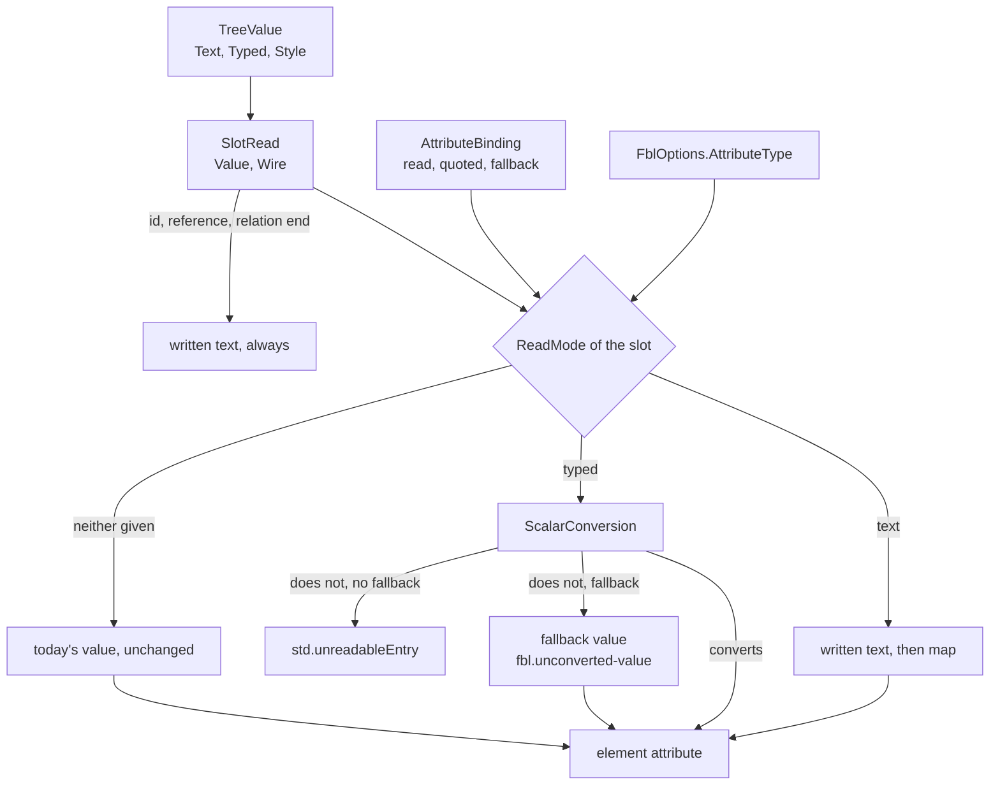

# Design Document

## Overview

`EtAlii.Adp.Specification.Fbl` is brought to FBL 0.5 in **seven steps, each one pull request with the four gates green**. The order is chosen so that a difference in a tool that already reads through the library can be attributed to one cause: the steps that cannot change any reading come first (1 and 2), the one change that reaches every caller of a `yaml` or `json` binding comes alone (3, ids and references), and the two changes that reach only a caller that hands over attribute types come after it, each alone (4 and 5).

Most of the written text is already in the reading. `TreeValue.Text` holds a scalar's decoded text beside `TreeValue.Typed`, and `SlotRead.Wire` already carries it for a scalar member (`Rules/TreeFamily.cs`, `ReadMember`). What the library lacks is using it: `BodyReading.ReadSlots` takes `SlotRead.Value`, which is the typed value, and `AssignId`, `KeyOf`, `End`, `CheckReferences` and `ReferencedBy` all turn that typed value back into text with `NewText.Plain`, which is where `007` becomes `7`. So the Performance requirement (one pass, no second parse) is met by construction.

**One item was outside the approved requirements** and was put as a selection under *Amendment approved*: deriving `FblOptions.AttributeType` from a DISL specification. Its option 1 was approved with this design's card on 2026-10-12, and it is Requirement 8 since that day. This design is written against it, as step 7, and steps 1 to 6 do not depend on it.

## Steering Document Alignment

### Technical Standards (tech.md)

- The language is etalii-adp/etalii.adp's. Nothing of FBL is decided here: where 0.5 is unclear the library takes the reading that changes no caller, and the point is listed for the delivery report (Requirement 7.3, *What FBL 0.5 leaves unclear*).
- Splices, never reserialization: a value kept through a `fallback` is never rewritten unless its own attribute is set, because a splice is planned per slot.
- The four gates, and a test seen to fail before the change it is written for, are the checks of every step.

### Project Structure (structure.md)

- The capability is added once, to the shared library, named for what it does. No module name enters the library and no module is edited.
- The vendored corpus is copied, never edited (`Conformance/readme.md`).

## Code Reuse Analysis

### Existing Components to Leverage

- **`TreeValue.Text`, `TreeValue.Style`, `SlotRead.Wire`** (`Rules/TreeFamily.cs`, `Rules/FamilyReader.cs`): the written text and the style, already produced by `YamlParser` (`ParsePlain`, `ParseQuoted`, block scalars, `Empty`) and `JsonFamily` (a string's decoded text, any other scalar's raw characters).
- **`TypedValue.Reads`** (`Rules/TypedValue.cs`) and **`BodyReading.Mistyped`**: today's type check. It becomes the conversion of step 5.
- **`YamlScalars.IsPlainSafe`, `IsPlainWritable`, `YamlFamily.String`**: FBL 6.3's writing rules, already quoting `yes` and `1.0` for a string value.
- **`FblCel` and `CelContext`** (`Expressions/`): the place the variables of an expression are declared.
- **`KnowledgeTypes`, `NaturalIds`** (`Fbl.Tests/Support/`): the pattern by which the conformance runner is given what a binding does not carry.
- **`DislTypeMap`, `DislType.Attributes`** (`EtAlii.Adp.Specification.Disl`): the `typeMap` and the flattened attributes, for step 7.

### Integration Points: who reads through the library

Searched with `grep -rln "EtAlii.Adp.Specification.Fbl" --include=*.csproj src` and then, for the use, `grep -rnE "OpenBody\.Open|PluginBody\.Open|new FblOptions|FblDocumentLoader\.|new FblElement" --include=*.cs src`. The seven projects the requirements name, plus `EtAlii.Adp.Specification.Disl` and the library's own test project.

| Caller | How it uses the library | Reached by |
| --- | --- | --- |
| Knowledge designer (`KnowledgeBody.cs`) | `OpenBody.Open`, bindings `yaml`, `json`, `xml`, with `AttributeType = KnowledgeDefinition.AttributeType`. **The only caller that hands over types.** | Steps 3, 4, 5 |
| Hype cycle graph (`GhgBody.cs`) | `OpenBody.Open`, a `yaml` binding, `new FblOptions { FileName = "body.ghg" }`: no types. | Step 3 only |
| Agent activity diagram (`AadBody.cs`) | `OpenBody.Open`, a `yaml` binding, `DeriveId` and `TimeAttributes`: no types. | Step 3 only |
| Behavior model (`AbmBody.cs`), mind map (`MindmapDefinition.cs`) | `PluginBody.Open` with their own plugin. `PluginBody.cs` uses neither `BodyReading` nor a tree family. | No step |
| Timeline (`TimelineDisl.cs`), dependency graph (`DependencyGraphFindings.cs`) | Build `FblElement` and `FblModel` records by hand for `DislModelBuilder.From`. Nothing is read. | No step; held by the records' constructors staying as they are |
| `EtAlii.Adp.Specification.Disl` (`DislModelBuilder`, `DislWrite`) | Consumes `FblModel`, produces `ModelChange`. | Step 7 adds to it |

## Architecture

### The steps

| Step | What changes | Held by | What must stay byte for byte, and which tests hold it |
| --- | --- | --- | --- |
| 1 | **The findings shown; written text on every scalar.** `Reading/WrittenText.Tests.cs` reads the six values of Requirement 1.1 and is seen to fail against the untouched library; the red run is recorded in the pull request. `TreeValue.Text` is proven to be FBL 4.1.5's written text for every scalar kind, and repaired where it is not (a flow collection's members, a value reached through a merge key). No slot reads differently. | 1, 2.1 | Everything. The whole suite, unchanged. |
| 2 | **Loader, model and expressions.** `read`, `quoted`, `fallback` read and refused; 0.5 loads without the warning; `text` and `style` beside `entry`. Nothing reads the new options yet. | 4, 5.1 | Everything. No vendored binding uses the options or the variables (searched the corpus and the four module bindings for `"read"`, `"quoted"`, `"fallback"`: none), so the whole suite is unchanged. |
| 3 | **An id, a reference and a relation's end are written text.** | 2.4 | Every attribute value. Ids change only where a file writes an id that YAML types. `ConformanceFixtures.Tests.cs` (11 fixtures), the three `KnowledgeFixtures` classes, `RealFiles/*`, `GhgTranscript.Tests.cs` against `ghg.transcript.json`, `AadExamples.Tests.cs`, `AadDocument.Tests.cs`, `AadCommands.Tests.cs`, the Knowledge designer's `Examples.Tests.cs` and `KnowledgeEditing.Tests.cs`. |
| 4 | **A slot reads text**: by `read: "text"`, or by a type given as `string`. `map` translates the written text. Writing reads back as the same text; `style: "plain"`. | 2.2, 2.3, 2.5, 2.6 | Every caller that hands over no types (hype cycle, agent activity: their tests above). The Knowledge designer is the one caller reached; its tests and the `knowledge-*` fixtures are the measure (Requirement 6.2). |
| 5 | **Conversion.** A slot read as typed converts to its attribute's type; `quoted`; `fallback`; `fbl.unconverted-value`. | 3 | The same as step 4. |
| 6 | **The corpus vendored again; the runner compares attribute values.** `timeline.fbl` at 0.5 and `timeline-written-text` enter; the runner is given the timeline's attribute types; the self-test of Requirement 5.5; the readme; `divergences.json`. | 5.2 to 5.5, 6.3, 7.1 | The eleven earlier fixtures pass with what they expect unchanged. No product code changes in this step. |
| 7 | **Attribute types derived from a DISL specification** (*Amendment approved*, option 1); the delivery report. | 8, 7.3 | Everything: a new class nobody calls yet. |

Steps 3, 4 and 5 are separate on purpose, as derivation and reading are in a conversion: step 3 is the only one that can move the hype cycle's or the agent activity diagram's transcript, and steps 4 and 5 are the only ones that can move a Knowledge designer attribute.

**Seen to fail first, and still green at the head of the pull request.** In step 1 the test of Requirement 1.1 is committed first with the 0.5 expectations and run: six red cases, each for the measured reason. It then lands with each case marked `OpenFinding(expected, today)`, a helper that asserts today's value and names the step that repairs it. Step 3 removes the marks of the id and the reference, step 4 those of the four labels. A mark still present after step 5 fails the suite. If a case is green on that first run, the defect does not occur and Requirement 1.2 applies: it is struck from the requirements as a small amendment, with the test.

### Modular Design Principles

- One concern per file: the mode of a slot, the conversion and the written text of a flow collection are separate classes; `BodyReading` only calls them.
- The legacy path is not rewritten. A slot with no `read` and no type takes the code it takes today, so Requirement 2.3 is held by not touching it and by the suites of the callers that hand over nothing.

## Components and Interfaces

### Written text (step 1)

- **Purpose:** every scalar of the `yaml` and `json` families has its written text (FBL 4.1.5).
- **Interfaces:** `TreeValue.Text` (exists); `SlotRead.Written`, a new member: `Wire` when the slot is a true scalar, otherwise `NewText.Plain(Value, null)`, which is already the text for `xml`, `lines` and `blocks`.
- **Verified:** `ParsePlain` trims, stops before a comment and folds continuation lines; `ParseQuoted` resolves escapes (`YamlScalars.DecodeDouble`, `DecodeSingle`); `YamlParser.Empty` leaves `Text` empty; `JsonFamily` keeps a number's raw characters.
- **To repair, each with a test seen to fail:** `FlowReader.Scalar` returns the typed value only, so a member of `[007, yes]` has no text: it gains a parallel reading of texts and styles. `ReadMember` sets no `Wire` for a value reached through a merge key. A flow collection has `Kind` `Scalar` and `Text` set to its raw characters, so `Written` must test the style, not the kind.

### `ReadMode` and the binding model (steps 2 and 4)

- **Purpose:** what a slot reads from a scalar.
- **Interfaces:** `AttributeBinding.Read` (`"text"`, `"typed"` or null), `AttributeBinding.Quoted` (`"convert"` or null), `AttributeBinding.Fallback` (a record `FallbackBinding(JsonElement Value, bool Report)`), all read in `BindingReader.ReadAttribute`. `ReadMode.Of(binding, type)` gives `Text`, `Typed` or `Legacy`: the binding's `read` first; else `Text` when the type given is `string` or the attribute is a reference; else `Typed` when a type is given; else `Legacy`.
- **The loader** refuses the three options, as an error at the option's pointer, on a slot of a binding whose family is `xml`, `lines` or `blocks`, and on a `value` or `capture` slot. The version check `minor > 1` becomes a constant `KnownMinor = 5`; `ANewerMinorVersionLoadsWithAWarning` moves from 0.2 to 0.6.
- **Dependencies:** `FblOptions.AttributeType`, called as today with the rule's type and the binding's attribute name (`BodyReading.Mistyped`).

### `ScalarConversion` (step 5)

- **Purpose:** the conversion table of FBL 5.2, replacing `TypedValue.Reads` and `Mistyped`.
- **Interfaces:** `Convert(type, typed, written, style, quoted)` returns the converted value or "does not convert".
- **Reuses:** `TypedValue.Reads` for `date`, `datetime` and `time`, which stay as they are.
- **In `BodyReading.ReadSlots`:** a typed slot whose scalar is empty (`key:`) is absent and takes `default`; a value that does not convert takes the `fallback` and reports, or, without one, makes the entry unreadable through the existing branch of `Claim`. The `SlotRead` keeps its span and its node, so the slot stays writable and setting the attribute replaces exactly those bytes, as the fixture's step on `row: wide` expects.

### Ids and references (step 3)

- `AssignId`, `KeyOf`, `End`, `CheckReferences` and `ReferencedBy` take `SlotRead.Written` where they take `NewText.Plain(read.Value, null)` today. `EditPlanner`'s rename compares a reference's written text with the old key (its line with `NewText.Plain(read.Value, null) != oldKey`). An id in a sidecar keeps its CEL key.

### Expressions (step 2)

- `CelContext.Tree` serves `yaml`, `json` and `xml` today (`BindingChecker` picks it by `rule.At is not null`). A new context `Scalars`, for `yaml` and `json`, declares `entry`, `text`, `style`, `parent`, `path`, `line`, `registration`; `Tree` stays for `xml`. An expression using `text` or `style` in another family then fails to compile at load, which is Requirement 4.3 with no extra check.
- `TreeFamily` gains `CelText` and `CelStyle` beside `Cel`, the same walk giving each scalar's `Text` or its style name. They are built only when the compiled expression names the variable, so a body whose binding does not use them costs nothing more.
- Requirement 4.2 is written as a test first. `TreeFamily.Cel` already puts a key with no value in the map as null; whether `has` then answers true is not verified by reading and is settled by the test.

### The conformance runner (step 6)

- `AssertRead` compares `attributes` where a fixture's element names them: the value and the JSON type, a string for a text. `Support/TimelineTypes.cs` reads the vendored `timeline.dis` as `KnowledgeTypes` reads `knowledge.des`, following `extends` (`label`, `begin` and `row` are declared on the abstract `Element`).
- **Vendored at one commit, `5c62e79`,** which the readme already names for `etalii.adp/`. It is after the merge of pull request 115 (`42da8ee`), and `specifications/fbl/` outside the `knowledge-*` fixtures is the same there as at today's `develop` of etalii.adp. A later commit would also bring `6de85af`, which changes `knowledge.fbl` and its fixtures for a feature the Knowledge designer here does not have. `timeline.dis` is added under `etalii.adp/definitions/diagrams/`.
- **The self-test of Requirement 5.5:** a copy of `timeline-written-text` made in the test's temporary folder with one expected label changed from the string `"yes"` to `true`; the runner must fail on it, naming the attribute.

## Data Models

### What a slot reads, by the type the caller gives

| Type given | Without `read` | Converts from |
| --- | --- | --- |
| none | as today (`Legacy`) | nothing is checked |
| `string` | the written text | always |
| `int` | typed | a long; a double with no fraction |
| `number` | typed | a long or a double |
| `bool` | typed | a bool |
| `date`, `datetime`, `time` | typed | a string that parses, as `TypedValue.Reads` today |
| any other name | typed value as it is | always, as today |

A quoted YAML scalar converts to `int`, `number` or `bool` only with `quoted: "convert"`. In `xml`, `lines` and `blocks` a value is text and converts from it, as today.

### The finding

`FindingCodes.UnconvertedValue` is `fbl.unconverted-value`, a warning at the value's span. `Finding` gains an init property `Detail` (a map with `attribute` and `text`); its positional constructor does not change, so no caller is touched. The message: "'wide' is not a whole number, so Row is read as 0. Write a whole number to change it."

## Amendment approved

**The record.** Option 1 below was approved with this design's card in the dashboard on 2026-10-12. Requirement 8 was added to the requirements on that day, and their Code Architecture sentence was widened to name `EtAlii.Adp.Specification.Disl` for that requirement only; that amendment has a card of its own, because an approval covers only its own file. The rest of this section is kept as it was put, and describes the requirements as they stood before Requirement 8.

**The requirement.** Requirement 2.2 reads the written text for "an attribute whose type the caller gives as a string", and the Code Architecture requirement keeps the change "inside `EtAlii.Adp.Specification.Fbl` and its test project". So the requirements leave it to each caller to hand over a list.

**The evidence.** `FblOptions.AttributeType` is a `Func<string, string, string?>` set in one product place, `KnowledgeBody.cs`, from a table the Knowledge designer builds from its own specification. A search of `EtAlii.Adp.Specification.Disl` for `AttributeType` finds nothing. `timeline-disl-fbl` names the derivation as its library item L2, "delivered once, by whichever of those specifications reaches its reading step first; the requirements name no owner". It cannot live in the FBL library: `EtAlii.Adp.Specification.Disl.csproj` references `EtAlii.Adp.Specification.Fbl.csproj`, not the reverse.

**The options.**

1. **Add it here as a requirement, built as step 7 in `EtAlii.Adp.Specification.Disl` (recommended, and approved on 2026-10-12 as Requirement 8).** One owner, delivered once, before any of the seven conversions needs it. It costs an amendment of the approved requirements: one new requirement and the architecture sentence widened to name that library. That is a change of scope, so it is a card and not a chat ruling.
2. **Leave it to `timeline-disl-fbl`**, as its design says. Nothing changes here; the six other conversions then wait on the timeline's reading step for a class that is not the timeline's.
3. **A small specification of its own.** Clean ownership, at the cost of one more approval round for about a hundred lines.
4. Other.

**Designed against option 1, which is Requirement 8.** `DislAttributeTypes`, a public static class: `Of(DislSpecification)` returns the function `FblOptions.AttributeType` takes, and `TimeAttributes(DislSpecification, FblBinding)` the set `FblOptions.TimeAttributes` takes, keyed `rule.attribute` as `YamlFamily` reads it. A binding type is resolved through `DislTypeMap.For`: its `As` to `Metamodel.TypeOf`, or to `Metamodel.DiagramAttributes` for `diagram`; a renamed attribute through `Attributes`; a host attribute is `string`, which FBL 5.2 reads as text; `header` and `unreadable` give no type. Tested against a specification with `extends`, a rename and a host attribute, each seen to fail first.

## What each waiting specification gets

Found by searching `.spec-workflow/specs/*-disl-fbl/` for `fbl-written-text`, "written text" and "scalar". The seven the requirements name are below. `helm-chart-disl-fbl` names the same gap (B7) only for the case that its YAML were declared, and stays a plugin. `causal-loop-disl-fbl` and `wardley-map-disl-fbl` have no match and wait on nothing here.

| Specification | What waits there | What it gets, and from which step | What still waits |
| --- | --- | --- | --- |
| `timeline-disl-fbl` | Steps 4 and 5; library items L1 and L2 | L1 from steps 3 to 6 (its binding is the vendored one); L2 from step 7 | Nothing of this kind |
| `dependency-graph-disl-fbl` | Steps 5 to 9, tasks 5 to 9 | Its step 5 is this specification: ids and ends from step 3, labels from step 4, the numbers `x` and `row` from step 5 | Its gaps 2 and 3, if it keeps them |
| `supply-chain-disl-fbl` | Steps 9 to 11, tasks 10 to 12 | Text from steps 3 and 4; numbers where the text decides (B2) through `read: "text"`, step 4 | Nothing of this kind |
| `sankey-disl-fbl` | Steps 8 to 11, task 9 | Gap 1 from steps 3 and 4; gap 2 (a value that will not read without losing its entry) from step 5; the quoted number through `quoted: "convert"` | Nothing of this kind |
| `functional-decomposition-graph-disl-fbl` | Steps 7 and 8, tasks 9 to 12 | Gap 1 from steps 3 and 4 | Gap 2, a constant an `insert` writes: FBL 0.5 has none (searched the specification for "constant": none) |
| `databricks-disl-fbl` | Task 10 and stage two | Gap 3 from steps 3 to 5, with `fallback` for a value such as `${var.workers}` | Gaps 1 and 2: several readings over one binding, a resource capture per reading |
| `azure-devops-pipeline-disl-fbl` | A declared reader, on its language gaps 1 to 8 | Its gap 2 (B1) from steps 3 and 4 | The other seven gaps; no task of it starts on this alone |

## Error Handling

### Error Scenarios

1. **A tool's transcript or fixture test changes at step 3, 4 or 5.**
   - **Handling:** the step is not delivered and nothing is regenerated. The difference goes to the Scrum master as a selection (Requirement 6.2): adjust the binding or the caller so the tool reads as before, or adopt the change on purpose, or other.
   - **User Impact:** none until it is ruled.

2. **The Knowledge designer reads a value differently**, which is expected to be found, because it is the one caller that hands over types. Three cases follow from FBL 5.2: a `string` attribute written `yes` or `12` becomes that text (step 4); a `number` written `"12"` in YAML, or as a JSON string, no longer converts (step 5); a typed attribute written `key:` takes its `default` (step 5).
   - **Handling:** as scenario 1, per case, with the fixture or example that shows it. The designer's own `knowledge.fbl` can ask for today's reading with `quoted: "convert"`.
   - **User Impact:** decided by the ruling.

3. **An id that YAML types is written in a real file** (`id: 007`, `id: 1.0`, `id: ~`).
   - **Handling:** from step 3 the id is the written text. `id: ~` and `id: null` become the ids `~` and `null`, where today they are a missing id; an empty `id:` stays missing.
   - **User Impact:** an element keeps the id its author wrote. A registration that stored `7` for such an element no longer finds it; the corpus of every caller is searched for such an id in step 3, and a hit is scenario 1.

4. **A value does not convert and the binding gives a `fallback`.**
   - **Handling:** the entry stays readable, the attribute is the fallback's value, the bytes are kept, and the finding is reported unless `report` is `false`.
   - **User Impact:** the element is drawn; the user is told which attribute and what was written.

5. **A file vendored in step 6 does not pass.** `work-board.fbl` (FBL 0.3) enters `RealFileCorpus.AllBindings`, which asserts that every vendored binding loads with no error; it has not been loaded here.
   - **Handling:** a construct the loader refuses is a runtime gap of this library, repaired in step 6 with its test, or, if it is larger than a loader change, reported to the Scrum master as a selection before the step lands. The vendored file is never edited.
   - **User Impact:** none.

6. **An expression uses `text` or `style` in an `xml`, `lines` or `blocks` binding.**
   - **Handling:** a load problem at the expression's pointer, from the compile.
   - **User Impact:** the tool engineer sees it when the binding is loaded.

## Testing Strategy

### Unit Testing

- `Yaml/YamlScalars.Tests.cs` and a new `Reading/WrittenText.Tests.cs`: the written text of each row of FBL 4.1.5, an alias, a merge key and a flow member.
- `Loading/Loading.Tests.cs`: the three options read; each refused in each forbidden place; 0.5 without a warning, 0.6 with one.
- `Reading/ScalarConversion.Tests.cs`: every cell of the table in FBL 5.2, replacing `Reading/TypedValue.Tests.cs` case for case.
- `Expressions/Expressions.Tests.cs`: `text.label` and `style.label` for each style; `has(entry.end)` for `end:` and for an absent key; the load problem of scenario 6.
- `Yaml/YamlWriting.Tests.cs`: a text `yes` written quoted and read back; `style: "plain"` writing it plain; a number replacing a quoted scalar under `quoted: "convert"` keeping its quotes; another attribute set beside an unconverted one leaving its bytes.

### Integration Testing

- **The conformance fixtures**, all of them, in every step. `MinimumFixtures` goes from 11 to 12 in step 6.
- **The Knowledge fixtures and their steps** (138 steps in each of three formats, 11 of `knowledge-kept`), unchanged in what they expect.
- **The real-file suite**; `divergences.json` loses an entry only where the divergence no longer occurs, each removal named in the pull request.
- **The callers' own suites**, as the steps table names them. They run in `dotnet test --solution EtAlii.Adp.slnx` and are judged by its captured exit code.
- **Round trip:** every fixture input, old and new, read and saved without a change gives no splice and the same bytes.

### End-to-End Testing

- None of its own: no tool changes. A newly created worktree is built before the gates are trusted at step 6, because it changes vendored files a test project copies.

## What FBL 0.5 leaves unclear (for the delivery report)

- Whether a DISL `text`, `color`, `uri` or enum attribute reads written text unasked. This design reads only `string` so, by the letter of section 5.2.
- Whether a number replacing a quoted scalar keeps the quotes without `quoted: "convert"`. This design keeps them only with it, so no caller's bytes change.
- The style name of a value reached through an alias, and of an empty value.
- Whether a JSON string converts to a number (`quoted` is stated for `yaml` only). This design does not convert it.

## Requirement Coverage

| Criterion | Where |
| --- | --- |
| 1.1 | Step 1; *Seen to fail first* |
| 1.2 | Step 1; the small amendment named there |
| 2.1 | Step 1; *Written text* |
| 2.2 | Step 4 (`read`, `string`); step 5 (typed, converted); *`ReadMode`* |
| 2.3 | Step 4; `Legacy`; the suites of the hype cycle and the agent activity diagram |
| 2.4 | Step 3; *Ids and references* |
| 2.5 | Step 4; `ReadSlots` maps `SlotRead.Written` |
| 2.6 | Step 4; `Yaml/YamlWriting.Tests.cs` |
| 3.1 | Step 5; *`ScalarConversion`*; Error scenario 4 |
| 3.2 | Step 5; *The finding* |
| 3.3 | Step 5; the existing unreadable branch of `Claim` |
| 3.4 | Step 5; `AttributeBinding.Quoted` |
| 3.5 | Step 5; `Yaml/YamlWriting.Tests.cs` |
| 4.1 | Step 2; *Expressions* |
| 4.2 | Step 2; the test written first |
| 4.3 | Step 2; the `Scalars` context; Error scenario 6 |
| 5.1 | Step 2; *The loader* |
| 5.2 | Step 6; vendored at `5c62e79`; the readme |
| 5.3 | Step 6; `AssertRead`, `Support/TimelineTypes.cs` |
| 5.4 | Step 6, and every step for the earlier fixtures |
| 5.5 | Step 6; *The self-test* |
| 6.1 | Steps 3, 4 and 5; the last column of the steps table |
| 6.2 | Error scenarios 1 and 2 |
| 6.3 | Step 6; Integration Testing |
| 7.1 | Step 6. `docs/architecture.md` and `docs/solution-structure.md` name the library by what it does and no version, so no sentence of theirs becomes false; step 7 checks again. |
| 7.2 | Every step |
| 7.3 | Step 7; *What each waiting specification gets*; *What FBL 0.5 leaves unclear* |
| 7.4 | The tasks document; this table is its input |
| 8.1 to 8.7 | Step 7; *Amendment approved*; `DislAttributeTypes` |
| Non-functional | Overview (one pass); Modular Design Principles; *The finding* (the message) |
