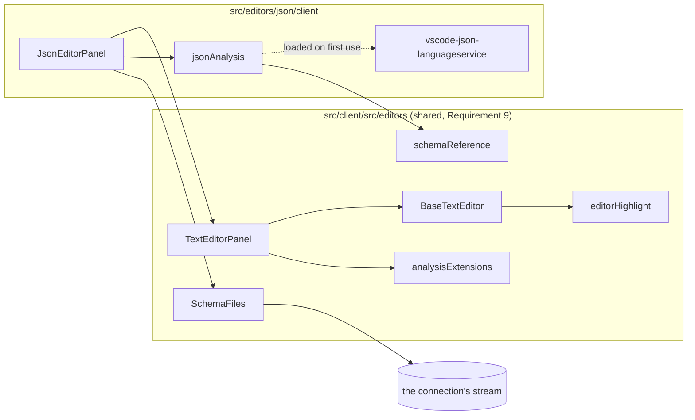

# Design Document

## Overview

The JSON editor is a new editor module, `src/editors/json/`, and four shared pieces in the client's editor folder that the YAML and XML editors reuse. The module's client wraps the shared `TextEditorPanel` with CodeMirror's JSON grammar and with an *analysis*: an object that answers findings, completions and hover text for a text. The JSON analysis is `vscode-json-languageservice`, loaded when the first JSON file is opened. Its backend is the family's session and nothing else.

The requirements were approved on 2026-10-12 as written, so every open question stands at its default: `.json` only (Q1), no schema from a web address (Q2), validation in the client (Q3), findings in the editor only (Q4), markdown gets colour (Q5), no `.eds` file (Q6).

**One sentence of the requirements cannot be met as written**, and this design is written for the alternative. It is asked as a ruling below and nothing is built on it before the answer.

## What was run before this design

Requirement 1 asks for a spike as the first task, with its result recorded here. A first run was made on 2026-10-12 in a scratch project outside the repository, with the repository's versions of Vite (8.3.4) and Vitest (4.1.11, jsdom). It is recorded here as a scratch run. **The task still stands**: it repeats this inside the repository, as tests that stay, and in a browser, which the scratch run did not do.

| Question | Answer | Known |
| --- | --- | --- |
| Does the service load and answer under the test runner? | Yes. For a fixed document and schema it gave findings, a completion and hover text. | Run |
| Does it build for production? | Yes, with no warning and no Node module left out. | Run |
| Does the built bundle answer? | Yes, when the built file was loaded by Node. | Run in Node. **Not run in a browser.** |
| What does it add? | 194,975 bytes minified, 45,983 gzipped, as a library build of the service and a ten-line caller. | Measured |
| How fast is it? | A 4,004-line document against a 6,276-line schema: validation 13 ms cold and 3 ms after, asking for completions 1 ms. | Measured in Node. The completion position offered nothing, so that figure is the cost of asking. |
| Which version? | `6.0.0-next.3`, the one npm's `latest` tag serves. It is marked a pre-release by its number and is what a plain install gives. | Read |

What the run showed that the design depends on:

- Schema findings are **warnings** unless the document settings say `schemaValidation: "error"`; with it they are errors and a deprecated property stays a warning. That is Requirement 6.1 and 6.3 by configuration.
- `comments: "error"` and `trailingCommas: "error"` give Requirement 4.3.
- A duplicate property name is reported on **both** occurrences, as a warning. Requirement 4.2 asks for the second; both is what the library gives and is kept.
- When the schema forbids additional properties, the document's own `$schema` property is reported as not allowed. That finding is wrong for the author and is **dropped** by the module (it is recognised by the property it sits on, not by its sentence).
- A reference the service cannot load comes back as one finding whose code is at or above the library's `SchemaResolveError`. That is the hook for Requirement 5.5.
- The service asks for a schema by URI through a callback the module supplies. A document handed over under a URI of the module's own scheme has a relative `$schema` resolved against it, so the module sees every schema request and decides each one.
- Hover text comes back with markdown escaping (`place\.`). The module asks for plain text and renders text nodes only.
- The library's source names the dialects draft-04, draft-06, draft-07, 2019-09 and 2020-12. That is a reading of the source; the spike task holds one test per dialect, and Requirement 6.5's list is whatever those tests show.

## Rulings asked

Each is a small amendment to an approved requirement, asked in chat as the rules for small amendments say. The design below is written for the first option of each.

| # | Requirement | What is asked | Options |
| --- | --- | --- | --- |
| A1 | 9.6: "the client SHALL get the text from the backend ... on a unary call" | How does the client read a schema that is a file of the project? | **(recommended) Over the stream every tab already uses**: the schema file is opened as one more document on the connection's existing stream, exactly as a text tab opens its file. Nothing is added to the backend, the path is confined to the project by the code that already confines a tab's path, and a change on disk arrives by itself, which is Requirement 5.8 for free. The sentence becomes "over the connection's existing stream". · **A new unary call** `EditorService.ReadText`, as written. Costs a call, its tests, and a second mechanism to learn that the file changed, which the call does not give. · Other. |

**Ruled by the user in chat on 2026-10-12: the first option.** The requirements were amended the same day.

## Steering Document Alignment

### Technical Standards (tech.md)

- **Commands.** The editor adds no state change of its own; a save is the family's `SaveTextFileCommand`.
- **One stream.** No stream is added. With A1 no call is added either.
- **Implementation order.** Data model, persistence and wire have nothing in them for this module: it has no model beyond text, persists nothing of its own and adds nothing to the wire. That is stated here so that the tasks need not carry empty steps.
- **Dependencies.** Each new package gets its row in `docs/dependencies.md` in the change that adds it.

### Project Structure (structure.md)

The module is `src/editors/json/` with the family's four folders. What is shared lives in `src/client/src/editors/`, where `TextEditorPanel` and `BaseTextEditor` already are. Nothing JSON-specific is placed there.

## Code Reuse Analysis

### Existing Components to Leverage

- **`TextEditorPanel`** (`src/client/src/editors/TextEditorPanel.tsx`): the tab, the dirty mark, the conflict banner, the status line. Extended, not replaced.
- **`BaseTextEditor`**: the CodeMirror view. It builds its state once at mount, so an extension cannot be swapped later. The shared pieces are therefore written to read what changes (the schema, the findings) through references, and to ask the view to lint again when a schema arrives.
- **`useEditorText`**: opens a file on the connection's stream and folds it to text, with a revision that counts arrivals. With A1 it is also how a schema file is read.
- **`@codemirror/language`**, already a dependency: `syntaxHighlighting`, `HighlightStyle`, `bracketMatching`, `foldGutter`, `indentUnit`.
- **`themeContrast.ts`** and its two tests: the instrument Requirement 3.3 is held with.
- **`PlainEditorSession`** and its tests: the shape of the module's backend session.
- **`DependencyInventoryTests`**: reads the workspaces globs of `src/package.json`, so a new workspace is counted without a change to the guard. Its `Expand` supports the shape `editors/*/client`, which is the shape `diagrams/*/client` already has.

### Integration Points

- **`toolPanels.ts`**: its glob already covers `editors/*/client/register.ts`.
- **`EditorDefinitionDiscovery`**: finds the module's `Editor.Definitions`.
- **`src/client/src/index.css`**: gains the syntax colour tokens, in both themes.

## Architecture



### Modular Design Principles

- The shared pieces know no format. Each takes a format's grammar or analysis as an argument.
- The language service is behind one file, `jsonAnalysis.ts`. Nothing else imports it, so the fallback of Requirement 1.4 would replace one file.
- The service is imported with `import()`, so its 195 KB are fetched when a JSON file is first opened and not with the shell.

## Components and Interfaces

### Shared piece 1: the workspace (Requirement 9.1)

`src/package.json` gains `"editors/*/client"` in `workspaces`. `src/editors/json/client/package.json` declares `@codemirror/lang-json` and `vscode-json-languageservice`. `@codemirror/lint` and `@codemirror/autocomplete` are declared by `src/client/package.json`, because the shared pieces there import them. The markdown and plain modules get a `package.json` with no dependencies only if the workspace glob requires every match to have one; the task finds out and does the lesser.

### Shared piece 2: colour (Requirement 9.2, 3)

- **`editorHighlight.ts`** exports one `HighlightStyle` that maps Lezer's tags to CSS variables: `propertyName`, `string`, `number`, `bool` and `null` (as keyword), `comment`, `punctuation` and brackets, `tagName`, `attributeName`, `attributeValue`, `meta`, `invalid`. Nine new tokens, `--color-syntax-name`, `-string`, `-number`, `-keyword`, `-comment`, `-punctuation`, `-tag`, `-attribute`, `-invalid`, are declared in `index.css` for the light and the dark theme as literal hex, because the contrast instrument computes from literals.
- **`BaseTextEditor`** installs `syntaxHighlighting(editorHighlight)`, `bracketMatching()` and `foldGutter()` for every editor. With Q5 at its default that is what gives the markdown editor colour; its panel does not change.
- **Property name against string value (3.2).** `@lezer/json` tags a property name `propertyName` and a string value `string`, so the two differ by construction; a test over a mounted editor asserts the two class names differ.
- **The guard.** `theme.contrast.test.ts` gains the nine tokens against `--color-surface` in both themes, at the ratio it already requires of text. A token-level test, for the reason `moduleThemeContrast.test.ts` records: jsdom applies no CSS, so a rendered check would pass against anything.

### Shared piece 3: findings (Requirement 9.3, 4.4 to 4.6)

```ts
export interface EditorFinding {
  from: number;            // offsets into the editor's text (LF-only, as CodeMirror holds it)
  to: number;
  severity: "error" | "warning" | "info";
  message: string;
  source: string;          // "json", "json-schema", ...: who found it
}

export interface EditorAnalysis {
  findings(text: string): Promise<EditorFinding[]>;
  completions?(text: string, offset: number, explicit: boolean): Promise<EditorCompletionList | null>;
  hover?(text: string, offset: number): Promise<EditorHover | null>;
  /** What the status line says about the schema: its title, "No schema", or why validation is off. */
  status?(text: string): string;
}
```

`TextEditorPanel` takes an optional `analysis`. **`analysisExtensions.ts`** turns it into CodeMirror extensions:

- `linter(source, { delay: 400 })` from `@codemirror/lint`: typing never waits, and findings follow a pause (Performance). The source drops an answer whose text is no longer the view's text.
- `lintGutter()` for the gutter mark; the underline is the lint extension's own, styled from the theme's `--color-danger`, `--color-warning` and `--color-text-muted`, with a wavy, a dashed and a dotted line respectively so that severity is not carried by colour alone (4.4).
- The sentence shows on hover through the lint tooltip and from the keyboard through the lint panel's keys (`F8` to the next finding), which are added to the keymap.
- The status line reads the counts from the lint state (`forEachDiagnostic`) and shows "2 errors, 1 warning" beside the dirty mark, and nothing when there are none (4.5), followed by `analysis.status`.
- Findings above each other on the same text are all in the tooltip, in severity order (6.6).

### Shared piece 4: completion and hover (Requirement 9.4, 7.3, 7.5, 7.6)

```ts
export interface EditorCompletion {
  label: string;
  detail?: string;         // shown beside the label
  info?: string;           // the schema's description, shown as text
  from: number; to: number;
  insert: string;          // may hold ${1} tab stops
  boost?: number;          // required properties first
}
export interface EditorCompletionList { items: EditorCompletion[] }
export interface EditorHover { from: number; to: number; text: string }
```

`analysisExtensions.ts` installs `autocompletion({ override: [source], activateOnTyping: true })` and `hoverTooltip`. Ctrl+Space, the arrow keys, Enter and Escape are `@codemirror/autocomplete`'s own keymap. `info` and hover text are set with `textContent`; nothing from a schema is ever assigned as HTML (Security). An insert with tab stops goes through the package's `snippet`.

### Shared piece 5: where a schema comes from (Requirement 9.5, 9.6, 5.2 to 5.9)

Two parts, because one is rules and the other is reading.

**`schemaReference.ts`** is the rules, as a pure function with no I/O:

```ts
export type SchemaTarget =
  | { kind: "project"; path: string[] }          // a file of the project
  | { kind: "bundled"; id: string }              // a schema ADP ships
  | { kind: "none"; reason: string };            // said once to the user

export function resolveSchemaReference(reference: string, documentPath: string[], bundled: ReadonlySet<string>): SchemaTarget;
```

A bundled address wins. A reference with a scheme (`http:`, `https:`, any other) that is not bundled is `none` with "is a web address; ADP reads schemas from the project" (Q2). A relative reference is joined to the document's folder segment by segment; a `..` that would step above the project root is `none` with "leaves the project" and is **not** clamped. That last point is deliberate: URL arithmetic clamps at the root silently, which would read a different file from the one named.

The cases live in one file, `src/fixtures/schema-reference-cases.json`, read by a Vitest test here and by an xUnit test of the XML module's C# twin (xml-editor Requirement 9.6). One list of cases, two implementations held to it.

**`SchemaFiles.tsx`** is the reading. It is a component that renders nothing: given a set of project paths it mounts one child per path, each calling `useEditorText` for that path, and reports each file's text and revision upward. A set that grows as `$ref`s are followed is a list of children that grows. A file that fails to open reports its failure as the reason. When a revision changes, the panel asks the view to lint again (5.8).

The bundled set is a `Map` of address to text. It is empty in this specification (5.3).

### The module: `src/editors/json/`

- **`backend/EtAlii.Adp.Editor.Json/Editor.cs`**: id `json`, title "JSON editor", icon `mdi-code-json`, extension `.json`, `Build` registering the session factory.
- **`JsonEditorSession` and its factory**: the family's contract and nothing JSON-specific. The session is the fourth of its kind after plain's and markdown's. This design does not lift the three into one, because no requirement asks it; it is named under *Not in this design*.
- **`client/register.ts`**: matches `editor/json`.
- **`client/JsonEditorPanel.tsx`**: `TextEditorPanel` with `extensions={[json()]}` and `analysis={jsonAnalysis}`; mounts `SchemaFiles` for the schemas the analysis currently needs.
- **`client/jsonAnalysis.ts`**: the only file that knows the service.
  - It gives the document the URI `adp-project:///` plus its path, creates the service with `schemaRequestService` and `clientCapabilities` asking for plain-text hover and documentation, and validates with `{ comments: "error", trailingCommas: "error", schemaValidation: "error" }`.
  - `schemaRequestService(uri)` reads the document's raw `$schema` (and each raw `$ref` it is asked for), passes it through `resolveSchemaReference`, and answers from `SchemaFiles` or the bundle, or rejects with the reason.
  - It maps each diagnostic's range to offsets, its severity to the three of `EditorFinding`, and applies three adjustments: a schema-resolve error becomes one `info` on the `$schema` line carrying the reason (5.5); the "not allowed" finding on the `$schema` property itself is dropped; an unsupported-dialect report becomes one `info` (6.5).
  - Completions are mapped to `EditorCompletion`; the service's `$1` tab stops become `${1}`; required properties get a boost (7.1). Without a schema the service is not asked (7.7).
  - `status` answers the schema's `title`, else the reference, else "No schema" (5.6, 5.7).
  - Above 1,000,000 characters it answers no findings and the status "Too large to check" (Performance). The figure is the design's; the measured cost at 4,000 lines is three milliseconds, so the bound is about memory and the wire, not speed.
  - A throw inside the service is caught once per document: findings fall back to the JSON grammar's own syntax errors from the Lezer tree, and the status says "Schema support stopped:" and the message (Reliability).

### Requirement 10: the EDSL list

`src/editors/json/readme.md` holds the list of 10.1, each item beside the file that implements it, and the link to the issue in etalii-adp/etalii.adp. Opening the issue sends content outside this repository, so the task asks the user before posting it.

## Data Models

None persisted. `EditorFinding`, `EditorCompletion`, `EditorHover` and `SchemaTarget` above are in-memory shapes of the client.

## Error Handling

| Scenario | Handling | The user sees |
| --- | --- | --- |
| `$schema` names a file that is not there | `SchemaFiles` reports the failed open | One information finding on the `$schema` line: the reference and "was not found in the project". No schema findings. |
| `$schema` is a web address | `resolveSchemaReference` answers `none` | One information finding naming the address and that ADP reads schemas from the project. |
| The schema file is not valid JSON | The service reports a resolve error | One information finding saying the schema could not be read, with the service's reason. |
| A `$ref` leaves the project | `none`, "leaves the project" | One information finding naming the reference. |
| The schema refers to itself | The service resolves references once per URI | Nothing; held by a test with a self-referring schema and a time limit. |
| The service throws | Caught in `jsonAnalysis` | Colour and syntax findings stay; the status line says schema support stopped and why. |
| The service fails to load (the chunk does not arrive) | The `import()` rejects | Colour stays; the status line says checking is unavailable. |

## Testing Strategy

### Unit Testing

- `schemaReference.test.ts` over the shared case file.
- `jsonAnalysis.test.ts`: one test per criterion of Requirements 4, 5, 6 and 7 that names a behaviour, each over a small document and schema, asserting ranges and severities, not sentences.
- `analysisExtensions.test.tsx`: a fake analysis; asserts the underline class per severity, the gutter mark, the status counts, that a stale answer is dropped, and that `info` reaches the DOM as text when it holds markup.
- `theme.contrast.test.ts`: the nine tokens.
- The spike tests of Requirement 1, kept: one per dialect, one for completion, one for hover.

### Integration Testing

- `JsonEditorPanel.test.tsx`: a mounted panel with a stubbed stream: a schema arriving after the document causes findings to appear; a new revision of the schema changes them.
- Backend: `Editor.Tests`, the session tests and `Examples.Tests` in the shape of the plain module's, including the byte-identical round trip and the replica under `src/examples/editors/json/`.
- `DependencyInventoryTests` and the startup conflict check run as they are and must stay green.

### End-to-End Testing

Entries in the module's `tests.md`, run against a local build in a browser, because jsdom shows neither colour nor a tooltip: open an example with a schema and see colour in both themes; break the schema and see the three carriers of a finding; complete a property with Ctrl+Space from the keyboard alone; edit the schema file in a second tab and see the first re-validate. The production-build half of Requirement 1.2 is the first of these.

### Every guard is seen to fail

Each test that is written for a behaviour is run once against the behaviour removed (the severity setting dropped, the `$schema` filter removed, the stale-answer check removed) and the failure is recorded in the task's log, as the repository's rule for guards requires.

## Not in this design

- Lifting the three editor sessions into one shared class. It is the right change and no requirement asks it; it is reported to the Scrum master as a refactoring candidate.
- A worker thread for the service. At three milliseconds a validation it is not needed; the `EditorAnalysis` interface is asynchronous throughout so that moving it later changes one file.
