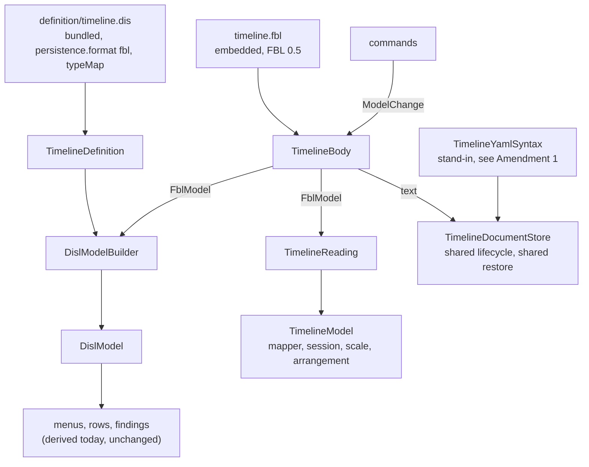

# Design Document

## Overview

The timeline is half converted: its toolbox, menus, rows and findings are derived from the bundled DISL definition, and one frozen transcript (`Parity/timeline.transcript.json`) holds them. This design is the other half, in **six steps, each one pull request, each held to that transcript**: the body read and written through the module's own FBL binding, and `TimelineParser`, `TimelineWriter` and `TimelineDisl` gone from the product code.

**The gap that stopped the first half is closed in the language.** FBL 0.5 (etalii-adp/etalii.adp pull request 115, merge `42da8ee`, 2026-10-10) gives every YAML scalar a written text (section 4.1.5), lets a slot ask for it with `"read": "text"`, reads a string attribute, an id and a reference as written text unasked (sections 5.2, 5.3), and adds `quoted` and `fallback`. The construct the requirements' appendix spells `"as": "text"` is `"read": "text"`. So Q3's default ("the design is written when FBL has the construct") is met, and the whole conversion is designed here.

**The library here does not implement 0.5 yet.** That is the specification `fbl-written-text` in this repository (requirements raised 2026-10-11, not yet approved). Steps 4 and 5 depend on its delivery; steps 1 to 3 do not and can start now. Searched for `"read"`, `"quoted"`, `"fallback"`, `WrittenText` and `UnconvertedValue` in `src/backend/EtAlii.Adp.Specification.Fbl`: none.

**What the module's reference to `EtAlii.Adp.Specification.Fbl` is used for today:** two record types and nothing else. `TimelineDisl.cs` builds `FblElement` and `FblModel` values by hand from the parser's reading, because that is the carrier `DislModelBuilder.From` takes. No binding is loaded, no body is opened, nothing is read or planned through the library. (The comment above the reference in the `.csproj` describes the DISL reference beside it.)

Two classes carry the conversion, in the shape the hype cycle graph has:

- `TimelineBody`: one `.tml` body opened through the embedded binding, giving the binding's reading, the DISL model built from it, and `Change(ModelChange)`.
- `TimelineReading`: the projection of that reading onto the module's `TimelineModel`, which the mapper, the session, the scale and the arrangement keep reading.

**Two points of the approved requirements were small amendments**, ruled by the user in chat on 2026-10-11, in *Amendments ruled*. Three findings the requirements do not list were found while verifying (B13 to B15, under *Data Models*); each gets a fixture in step 1 as Requirement 1 asks of a finding.

## Steering Document Alignment

### Technical Standards (tech.md)

- *Specifying a diagram type*: the definition lives in etalii-adp/etalii.adp and is bundled with `bundle-disl.sh`, never edited here. The binding is the module's own file, named by the definition by URL, as the hype cycle's is.
- Splices, never reserialization: the module's rule for its writer becomes FBL's rule, which is stricter (a value's span, not a line).
- The four gates, the transcript, and "a test seen to fail first" are the checks of every step.

### Project Structure (structure.md)

- A diagram type adds declarations and no core code. What the libraries lack is added to the libraries once, named for what it does (*Library work*), and no module name enters a library.
- The module gains one embedded `.fbl`. The test project gains the oracle (the parser and the writer) under `Parity/`.

## Code Reuse Analysis

### Existing Components to Leverage

- **`OpenBody` (`Open`, `Fork`, `Plan`, `Change`, `Apply`, `Model`, `IsReadOnly`), `FblDocumentLoader.Load`, `ModelChange` (`Add`, `Set`, `Remove`), `PlanResult`, `FblOptions`**: used as `GhgBody.cs` uses them, including its cache of recently read bodies and its batch of changes planned against one reading.
- **`DislModelBuilder.From(FblModel, DislSpecification)`**: already applies `persistence.typeMap` (`DislTypeMap`): a reference attribute mapped to `source` or `target` makes a relation whose end is kept as `SourceId` or `TargetId` when it names nothing, and `hostAttributes` are kept beside the model. This is what answers findings B2 and B3, and the hype cycle's definition uses exactly this.
- **`DislValues.TryFromRead`**: types a read value by its attribute, through its text; an `int` that does not parse stays unset and reads as its default. This is today's "a row that will not read is row zero" (finding B13).
- **`EditPlanner.Binding`**: a `Set` of an attribute the element's own rule does not bind is written by another rule that matches the same entry. Its comment names this tool: "a timeline Moment given an end is written by the Period rule's binding". So giving and removing an end are one `ModelChange.Set`, and no retype is planned (a declared binding refuses `ModelChange.Retype`; FBL 6.4 would plan it as a remove and an add, which would lose the entry's place and cascade its relations).
- **`YamlFamily` insert**: copies the previous sibling's dash column and key column (`Item`, with the gap computed from both), and opens an empty flow sequence into a block sequence. Both read in the code; findings B7 and B4 are therefore expected to stay gaps of FBL's text only, which the fixtures of step 1 confirm or refute.
- **`ConstraintEvaluator` with `DislConstraintOptions.WrittenId` and `ReaderFindings`**, `ContextMenuDerivation`, `FormDerivation`, `ToolboxDerivation`, `OperationInterpreter`, `DeletionPolicy`, `WireIdMap`, `BundledDefinition`: used by `TimelineDefinition` today and unchanged.
- **`RestoreDocumentCommand` and `RestoreDocumentCommandHandler`** (`EtAlii.Adp.History`): the shared restore. The timeline does not use it today: its commands answer with the same command carrying the previous values, and a removal with `RestoreTimelineLinesCommand`. Requirement 3.6 moves it onto the shared one, as `GhgEdits` does.
- **`Parity/TimelineTranscript.cs`, `TranscriptText.cs`**: the generator and the comparison exist and are kept; only the corpus grows.

### Integration Points

- **etalii-adp/etalii.adp**: `definitions/diagrams/timeline.dis` changes its `persistence` (finding A1) and `timeline.md` its account of the document on disk, through that repository's own pull request. Step 3 depends on it being merged. The example `specifications/fbl/timeline.fbl` is **not** changed: it is the subject of three conformance fixtures (`timeline-edits`, `timeline-bom-lf`, `timeline-written-text`) whose expectations rest on its relation rule and its header. Requirement 6.2 allows the difference to be recorded, and this design records it (*Data Models*).
- **`fbl-written-text`** (this repository): delivers FBL 0.5 in the library and vendors the corpus again. Steps 4 and 5 start when it is merged.
- **`EtAlii.Adp.Specification.Fbl.Tests`**: `RealFiles/ModuleCrossCheck.Tests.cs` calls `TimelineParser.Parse` for its timeline leg and references the module's project. When the parser moves to the module's test project (step 4), that leg compares the vendored example's reading with the module binding's reading (`TimelineBody`), which is the comparison Requirement 6.2 asks for. The four timeline entries of `divergences.json` are held against the vendored example, which keeps its relation rule and its id rule, so the three for `dangling.tml`, `combined.tml` and `identity.tml` still occur and stay; they are reworded as differences between the two bindings.

## Architecture

### The steps

| Step | What changes | Held by | Depends on |
| --- | --- | --- | --- |
| 1 | Fixtures for B4 to B7 and B9 to B15; the transcript regenerated from unchanged code and its diff reviewed as new documents only; one test per finding that reads or edits its fixture through the vendored example binding and is seen to fail for the finding's reason. No product code changes. | Requirement 1 | Nothing. Can start now. |
| 2 | In etalii.adp: the definition's `persistence` as `format: "fbl"`, `binding`, `ids`, `view` and `typeMap`; `writtenEnd` documented as reading the end the relation keeps; `timeline.md`. | Requirement 2.1, findings A1, A2 | Nothing. Can start now. |
| 3 | The definition bundled again; `BundledDefinition.Tests` with the new sha256; a newly created worktree built. The model is still built by `TimelineDisl` from the parser, and the transcript is byte-identical: `DislModelBuilder` falls back to the element's own ends where no mapped attribute gives them, so the `typeMap` is inert for a hand-built reading. | Requirements 2.1, 7.2 | Step 2 merged in etalii.adp. |
| 4 | **Reading.** `timeline.fbl` embedded; `TimelineBody`, `TimelineReading`; the DISL model built by `DislModelBuilder` from the binding's reading; `TimelineDisl` deleted; `TimelineParser` moved to `Parity/` as the oracle. Writes still go through `TimelineWriter`, on line ranges taken from the reading's spans. Transcript byte-identical. | Requirements 2.2 to 2.7, 4.1 | `fbl-written-text` merged (its Requirements 2, 3 and 4); library item L2; step 3. |
| 5 | **Writing.** Every command plans a `ModelChange` on `TimelineBody` and answers with the shared restore; `TimelineWriter` moves to the oracle; `RestoreTimelineLinesCommand` and the module's use of `LineSplice` go. The transcript's edit hunks and `undoAll` lines are regenerated once and the diff reviewed (Q1, Amendment 2). | Requirement 3, 4.1 | Step 4; `fbl-written-text` Requirement 2.6. |
| 6 | Closing: the table of remaining classes and the gaps in `timeline.md` (etalii.adp, bundled again); `divergences.json`; the three documentation pages; the delivery report. | Requirements 4.3, 6, 7.1 | Step 5. |

Derivation changed in the first half and does not change here. Steps 3, 4 and 5 are separate so that a difference in the transcript is attributable: to the definition, to reading, or to writing.

### Modular Design Principles

- One concern per file: the body, the projection, the syntax stand-in, and the commands' shared edit helper are separate classes.
- Each command keeps its record and its handler's signature, so history and the wire are untouched; only the handler bodies change.
- No module name enters a library; no library type is subclassed by the module.

## Components and Interfaces

### TimelineBody

- **Purpose:** one `.tml` body, read and written through the binding.
- **Interfaces:** `Parse(text)`; `Text`; `Model` (FBL); `Disl` (the DISL model); `LinesOf(Span)`; `Change(ModelChange)`; `Batch(Action)`.
- **Dependencies:** `EtAlii.Adp.Specification.Fbl`, `TimelineDefinition.Specification`.
- **Reuses:** `GhgBody` almost line for line, including `RecentBodies` and `Batch`. Arrange diagram writes many rows, each to its own entry, and is planned as one edit through `Batch` (Performance). The series copies this class per tool; lifting the cache and the batch into the library is a shared item no specification of the series has claimed, and it is not done here.
- **Options:** `FblOptions` with the attribute types and the time attributes of the definition (library item L2), so that `label` reads its written text unasked, a row is written plain, and a begin is written plain as a time.

### TimelineReading

- **Purpose:** the binding's reading as the `TimelineModel` the module's host code reads.
- **Interfaces:** `Of(TimelineBody)` returns a `TimelineModel`: per element its written id (`storedId`, empty for none), label, begin and end as `TimelineInstant` (through `TimelineInstants.Parse`, as the parser does), row, and its line range from the entry's span; per relation its id, `from`, `to`, label and range.
- **Why it exists:** `TimelineElementMapper`, `TimelineSession`, `TimelineScale`, `TimelineArrangement` and `TimelineContextSourceResolver` read `TimelineModel` and are kept by Requirement 4.2. Feeding them the same model keeps the payloads byte-identical without touching them.

### TimelineDefinition (changed, not new)

- `Menus`, `Rows`, `Problems`, `Addition`, `Grown`, `RelatedHere`, `EndChange` and `RemoveConfirmation` take the body's DISL model in place of `TimelineDisl.Of(model)`. `ElementOf` and `WrittenIdOf` read the host attribute `storedId`, as `GhgDefinition.WrittenId` does.
- **Findings.** `Problems` hands `ConstraintEvaluator` one kind of reader finding only: `std.unparseable`. The library's own findings (`fbl.duplicate-key`, `fbl.header-mismatch`, `std.unreadableEntry`, and its notes on a missing or repeated id and a dangling reference) are not forwarded: the last three are reported by the definition's own rules under the tool's codes, and the first three are the findings Q2 switches off. The list is one named set in the class and is recorded in `timeline.md`.
- **`writtenEnd`** (finding A2, confirmed as "stays"). `std.references` cannot replace the two dangling rules: it reports every unset end, and the tool does not report an end written empty or not written at all. The function stays in the time plugin and reads `DislElement.SourceId` and `TargetId`, which the builder sets from the mapped reference attributes. The host attributes `writtenFrom` and `writtenTo` go.

### TimelineYamlSyntax (the stand-in of Amendment 1)

- **Purpose:** today's answer to "is this YAML, and if not, why and where".
- **Interfaces:** `Check(text)` returns nothing, or YamlDotNet's message and line.
- **How it is reached:** `TimelineDocumentStore.Parse` and `TimelineValidator` ask it first. A text it refuses is the unusable entry of today, with today's sentence in the panel and on the canvas, and is never handed to a command. A text it accepts is read by `TimelineBody`; if the library still finds the body unreadable, the library's reason and line are reported under the same code.
- **Why code:** FBL 7.5 leaves the wording and the exact acceptance of an unreadable body to each host's YAML reader. The class is about 25 lines, keeps the `YamlDotNet` reference for reading only, and is deleted when Q2's follow-ups are ruled on.

### The commands

- `TimelineEdits` becomes the one place an edit is run, in the shape of `GhgEdits`: open the body of the store's text, refuse an unusable document with today's sentence, run the handler's checks (unchanged, with today's sentences), plan the change, store the text, and answer with `RestoreDocumentCommand` carrying the text before and the command as its redo.
- Add: `ModelChange.Add` of binding type `Period` or `Moment` with the minted id. Connect: `Add` of `Connection` with `from` and `to` as the written ids; the binding creates `connections:` at the end of the document for the first one. Rename, relabel, placement: `Set`. Give or remove an end: `Set` of `end` (above). Remove: `Remove`, which cascades to the relations whose `from` or `to` holds the element's written id; the count asked beforehand is `DeletionPolicy.Confirmation`, as today. Arrange: `Batch` of `Set` of `row`.
- `AddConnectedTimelineElementCommand` (an element and its relation in one undo step) plans two changes on one body and stores once.

## Library work (Requirement 5)

| # | What | Delivered by | Why |
| --- | --- | --- | --- |
| L1 | FBL 0.5 in `EtAlii.Adp.Specification.Fbl`: written text, `read`, `quoted`, `fallback`, `text` and `style` in CEL, the corpus vendored again with `timeline.fbl` and `timeline-written-text`. | `fbl-written-text`, once, for the seven specifications that wait on it. This specification adds no task for it. | Requirement 5.1, finding B1 |
| L2 | The attribute types and time attributes of a DISL specification as `FblOptions.AttributeType` and `TimeAttributes`, resolved through `typeMap` (a host attribute has no type and reads as text, FBL 5.2). Searched for `AttributeType =` and `TimeAttributes =` under `src`: only the Knowledge designer (from DESL), the agent activity diagram (a literal set) and tests; `EtAlii.Adp.Specification.Disl` has no such member. Added there, with a test seen to fail first. | Shared: every tool of the series that reads a declared binding under a DISL definition needs it. Delivered once, by whichever of those specifications reaches its reading step first; the requirements name no owner. | Requirement 2.2: without the type, `fbl-written-text` Requirement 2.3 keeps a slot reading as today, typed. |
| L3 | Any defect of the library a fixture of step 1 shows (Requirement 5.2). Candidates by reading: an empty `end:` presented so that `has(entry.end)` is false (B11); a time in a .NET-only form rewritten on a move (B12). | This specification, in the library, each with its fixture. | Requirement 5.2 |

Not library work, verified: opening an empty flow sequence and copying the gap after a dash are both in `YamlFamily`; a moment given an end is in `EditPlanner`; an unset relation end and host attributes are in `DislModelBuilder`.

## Data Models

### The module's binding against the example in etalii.adp

The module's `timeline.fbl` is at FBL 0.5 and differs from the example in these named ways, each recorded in `timeline.md` (Requirement 6.2):

| Difference | Why |
| --- | --- |
| A relation is an element rule `connection` with `from` and `to` as reference attributes `by: "storedId"`; `typeMap` maps them to `source` and `target`. | Finding B2: a relation whose end names nothing is kept and reported by the tool's rule. |
| Every rule reads `storedId` from the `id` key, read-only, a host attribute. | Finding B3: a later holder of an id is addressed by its place, and the tool reports and finds it by what is written. |
| No `header`. | Finding B9, Q2: a missing or other `timeline:` raises nothing. The key stays unbound and is kept; the template still writes it. |
| `row` is `"read": "text"` with `default: 0`, without `quoted` and `fallback`. | Finding B13, below. |
| `begin` has `default: ""`. | Finding B14, below. |
| The `connection` rule has `when: "entry.all(k, true)"`, as the hype cycle's rules have. | Finding B15, below, and B8: an entry that is not a mapping is taken by no rule. |

`label`, `from`, `to` and `storedId` need no `read`: a string attribute, a reference and a host attribute read written text under 0.5. `begin` and `end` keep `"read": "text"` and `time: "keep-precision"` as the example has them. `end` on the period rule keeps `empty: "remove"`. The `typeMap` is the one drafted in the requirements' appendix.

### Findings added by this design, each with a fixture in step 1

| # | Finding | Kind | Resolution |
| --- | --- | --- | --- |
| B13 | **A row.** The parser reads a row with .NET's integer parse of the scalar's text: `1.0`, `0x10` and `0o17` are row 0, and `"3"` is 3. FBL 0.5 converts a typed value to an int attribute: `1.0` is 1, `0x10` is 16. | Definition defect | The binding reads the row as text; `DislValues.TryFromRead` and `TimelineReading` parse it as the parser does. |
| B14 | **A missing `begin`.** The parser reads it as the empty text, which the tool reports as an unreadable time. An absent slot leaves a `datetime` attribute unset, which reads as null in CEL, and a rule that fails on null raises nothing. | Definition defect | `default: ""` on the slot. |
| B15 | **A relation entry that is not a mapping.** The relation rule has no `when`, so it would take a scalar item and read a relation without an id, reported as `timeline.missing-id`. The parser passes it over. | Definition defect | The `when` above. |

### The transcript

Unchanged in shape. It grows by the fixtures of step 1. At step 5 its `hunks` change (Q1) and its `undoAll` lines change from "the original text is NOT back" to "the original text is back" where they say so today (Amendment 2). Nothing else changes in any step.

## Amendments ruled

Both are small amendments in the sense of the ruling of 2026-09-25. They were put to the user as selections and **ruled by the user in chat, 2026-10-11: the first option of each**, which this design was written against; Requirements 4.2 and 1.3 carry the rulings. The options stay listed, so that the record shows what was chosen from.

**1. The sentence of `timeline.unparseable` is YamlDotNet's.** Requirements 2.5, 2.6 and 2.7 keep the finding's sentence, line and the transcript byte for byte; Requirement 4.1 and the modularity rule remove the parser and name what stays. The transcript's entry for `unparseable.tml` reads "This is not YAML that can be read: While scanning a plain scalar value, found invalid mapping." at line 4: the reason is YamlDotNet's exception text, and which files are refused is YamlDotNet's decision (finding B10 rests on it). The library has its own YAML reader with its own reasons. Options:

- **Keep a named stand-in, `TimelineYamlSyntax`, and add it to Requirement 4.2 (recommended).** Nothing a user reads changes and a file with a repeated key stays refused, which is what Q2's default says of B10. The cost is one small class and the YamlDotNet reference, until Q2's follow-ups are ruled on.
- **Let the library decide and word it.** The parser's last trace goes now. The cost is a changed sentence for every file that is not YAML, a file with a repeated key that now opens with the first key bound and no word said, and Requirement 1.3 naming one more change.
- Other.

**Ruled by the user in chat, 2026-10-11: the first option.**

**2. Requirement 3.6 changes the transcript, and Requirement 1.3 names only Q1 and Q2.** Undo through the shared restore puts the bytes back, so the transcript's `undoAll` lines that today record "the original text is NOT back" (for `simple.tml`, after 25 undone steps, among others) become "is back". Options:

- **Requirement 1.3 also names what Requirement 3.6 demands (recommended):** the `undoAll` lines are regenerated with the hunks at step 5 and reviewed in the same diff. The cost is none; it is what 3.6 asks.
- **The commands keep their own inverses** and `undoAll` stays as recorded. The cost is that Requirement 3.6 is not met.
- Other.

**Ruled by the user in chat, 2026-10-11: the first option.**

## Error Handling

### Error Scenarios

1. **The binding or the bundled definition does not load.**
   - **Handling:** `TimelineBody` and `TimelineDefinition` throw on first use with the loader's problems; `BundledDefinition.Tests` and a binding-loads test fail in the gate.
   - **User Impact:** none in a released build.

2. **A body that is not YAML.**
   - **Handling:** `TimelineYamlSyntax` refuses it; the store keeps an unusable entry with an empty model; every command is refused before it reaches the body.
   - **User Impact:** today's one finding and today's refusals, such as "This timeline does not parse, so nothing can be edited until the file is fixed."

3. **A body YamlDotNet reads and the library does not.**
   - **Handling:** the library's unreadable body is reported as `timeline.unparseable` with the library's reason; the document is unusable. A corpus file for which this happens fails the transcript at step 4 and is a library defect (L3), not a fixture to change.
   - **User Impact:** none expected; if it occurs, a file that opened no longer opens, which the step is not delivered with.

4. **The library refuses a change** (an element gone, an id already used, a value it cannot write).
   - **Handling:** the handlers' own checks run first and keep today's sentences (Requirement 3.8); a refusal that still comes from the library is shown as the library words it, and the transcript pins every refusal the script reaches.
   - **User Impact:** the sentence shown today; the document unchanged.

5. **An entry the binding does not read** (a sequence item that is not a mapping).
   - **Handling:** taken by no rule, kept byte for byte, and the library's `std.unreadableEntry` is not forwarded (Q2).
   - **User Impact:** none, as today.

6. **The transcript differs after a step.**
   - **Handling:** the step is not delivered. The difference is a regression unless it is a hunk or an `undoAll` line at step 5.
   - **User Impact:** none.

7. **`fbl-written-text` is not delivered, or delivers 0.5 differently from what the binding needs.**
   - **Handling:** steps 4 and 5 wait; nothing is built on a workaround (Q3). A difference found at step 4 is reported to that specification's owner, and to etalii.adp if it is FBL's.
   - **User Impact:** none; the tool keeps working on its parser.

## Testing Strategy

### Unit Testing

- `TimelineReading`: per fixture, the projected `TimelineModel` equals the oracle parser's, field by field, ranges included. This is the test that says the mapper's input did not change, and it names the element where it does.
- `TimelineYamlSyntax`: the message and the line for `unparseable.tml`, and nothing for every other fixture.
- Library item L2: the type of a mapped attribute, of a renamed one, and none for a host attribute; seen to fail first.
- `BundledDefinition.Tests`: the embedded bytes equal `definition/`, the recorded sha256 holds, the definition loads with no error.

### Integration Testing

- **The transcript test** holds every step. At step 1 it is regenerated from unchanged code and the diff shows new documents only.
- **One fixture and one test per finding** (Requirement 1.1, 1.2): `first-element.tml` (B4), `trailing-comment.tml` and `quoted-values.tml` (B5), `give-end.tml` (B6), the existing `indentation.tml` with an add (B7), `no-header.tml` and `other-version.tml` (B9), `duplicate-key.tml` (B10), `end-shapes.tml` with an empty, a mapping and a sequence `end` (B11), `dotnet-times.tml` with a move (B12), `rows.tml` (B13), `no-begin.tml` (B14), `scalar-connection.tml` (B15). Each test reads or edits its fixture through the vendored example binding, compares with the transcript, and is seen to fail for the finding's reason; a finding whose test does not fail is struck by a small amendment. The observed differences are then pinned in a recorded list, in the manner of `divergences.json`, so that a difference that stops occurring fails too.
- **Written text** (step 4): a fixture `written-text.tml` with labels `yes`, `1.0`, `null` and `~`, an id `007` and a reference `7`, compared with the oracle; seen to fail against the library before `fbl-written-text`.
- **Round trip** (Requirement 3.7): every document of the corpus read and saved without a change gives no splice and the same bytes, the two line-ending fixtures and `no-trailing-newline.tml` included; every edit of the script undone restores the bytes.
- The store, session, reloader, mapper, scale, rows and arrangement tests stay and pass unchanged. `TimelineParser.Tests` and `TimelineWriter.Tests` move with their subjects to the oracle; `TimelineCommands.Tests` assertions on written lines are replaced by the transcript where Q1 changes them, each accounted for in the tasks.

### End-to-End Testing

- A `tests.md` entry, run in a real browser against a local build: open the example, rename an element whose line carries a trailing comment and see the comment kept, add a first element to a new timeline, connect two elements in a file without `connections:`, undo each, and compare the file with its original.
- A newly created worktree is built before the gates are trusted at steps 3 and 6, because both change what is embedded from `definition/`.

## What remains in the module, and why

| Class | Stays because |
| --- | --- |
| `TimelineArrangement`, `TimelineRows`, the arrange commands | The definition names the row arrangement as a plugin (Requirement 4.2). |
| `TimelineTimes`, `TimelineInstants`, `TimelineScale` | The definition names the reading of times as a plugin: DISL's CEL has no timestamps, and the tool reads every form .NET reads. |
| `TimelineElementMapper`, `TimelineReading`, `_Model/` | Payloads and the viewport are the host's wire; the projection feeds them what they read today. |
| `TimelineSession`, `TimelineSessionFactory`, `TimelineDocumentStore`, the reloader, `TimelineDocumentFactory` | The shared document lifecycle. The factory returns the binding's `template.text`. |
| `TimelineDefinition`, the three providers, `TimelineValidator`, `TimelineContextSourceResolver` | Handing out what is derived, mapped to the host's types; the grouping of findings, which `constraints.order` cannot state (recorded in `timeline.md` already). |
| `TimelineBody`, `TimelineEdits`, the command records and handlers | The host's commands and history; each handler is its checks and one planned change. |
| `TimelineYamlSyntax` | Amendment 1: FBL does not word or fix the refusal of a body that is not YAML. |
| `TimelineNewPlacement`, `TimelineRelationGesture` | Gesture ids on the wire. |

`TimelineParser`, `TimelineWriter` and `TimelineDisl` are gone from the product code; the first two live in `Parity/` as the oracle, the third is deleted.

## Language gaps to report (Requirement 6)

Recorded in `timeline.md` with the fixture that shows each, and listed in the delivery report: FBL's text on opening an empty flow collection (B4) and on the gap after a dash (B7), which the library does and the text does not say; a relation with an unset end and an id held twice (B2, B3), which every hand-edited format needs and FBL could say once; a retype between two rules that match one entry, which FBL 6.4 plans as a remove and an add where a single key decides the type; and the wording and acceptance of an unreadable body (Amendment 1). Gap 1 of the requirements' section C is closed by FBL 0.5.

## Requirement Coverage

| Requirement | Where |
| --- | --- |
| 1 | Step 1; *Findings added by this design*; Testing Strategy (one fixture and one test per finding); *The transcript*; Amendment 2 for 1.3 |
| 2 | Steps 2 to 4; *TimelineBody*, *TimelineReading*, *TimelineDefinition*; *The module's binding against the example*; Amendment 1 for 2.5 to 2.7; Error scenarios 2, 3 and 5 |
| 3 | Step 5; *The commands*; *Existing Components* (the planner, the insert, the shared restore); Error scenario 4; Testing Strategy (round trip) |
| 4 | Steps 4 to 6; *What remains in the module*; Amendment 1 for 4.2 |
| 5 | *Library work* (L1 by `fbl-written-text`, L2 shared, L3 from the fixtures); no module name in a library |
| 6 | Step 6; *Language gaps to report*; *Integration Points* (the cross-check and `divergences.json`, the example binding's recorded difference) |
| 7 | Step 6 for the pages (`docs/creating-a-diagram-module.md` names the parser and the writer as the worked example); the gates and the fresh worktree at steps 3 and 6; 7.3 is the tasks document's own check |
