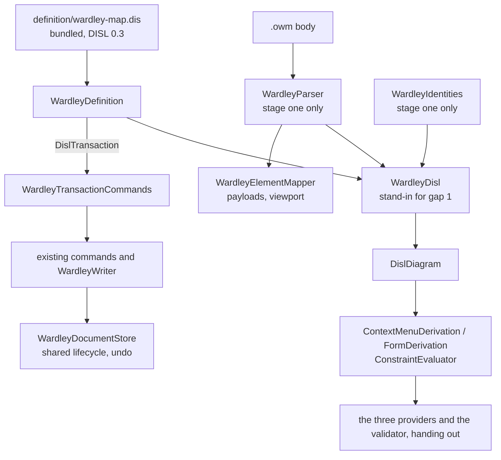

# Design Document

## Overview

The Wardley map is converted in **two stages, as the timeline was** (Q5 at its default). Stage one is **nine steps, each one pull request, each held to one frozen transcript**: the transcript is generated from today's hand-written code (step 1), the module defects the requirements name are repaired in that code (step 2), and every later step replaces one hand-written part by its derived equivalent and must reproduce the transcript byte for byte. Stage two is **two steps that wait** on changes to FBL in etalii-adp/etalii.adp: the body read through the binding, and every edit written by splices. *What waits, and on what* says exactly which criteria that leaves open.

After stage one the module has the shape the timeline has today. Three classes carry it:

- `WardleyDefinition`: the bundled DISL definition loaded once, and what the providers derive from it (palette, menus, rows, confirmation, findings), mapped to today's wire ids by its `x-wardley` block.
- `WardleyDisl`: the DISL model of one map, built from what `WardleyParser` read and from the store's identities. It is the one class Requirement 4.3 asks for, named as standing in for gap 1 of section C, and it is deleted in stage two.
- `WardleyTransactionCommands`: maps a transaction the definition's operations produce onto the module's existing command records, because until stage two every write is a splice `WardleyWriter` makes.

After stage two those two stand-ins are replaced by `WardleyBody`, the shape `GhgBody` has.

**Three points of the approved requirements were put to the user as small amendments and ruled in chat on 2026-10-11**, in *Amendments ruled*. Two were ruled as this design was written; the third, two elements of one kind with one key, was ruled otherwise and changes what the tool does: each gets an id of its own (*Identities of a repeated key*). The seven choices that ruling left open were put to the user as a selection and ruled in chat on 2026-10-12.

## Steering Document Alignment

### Technical Standards (tech.md)

- *Specifying a diagram type*: the definition lives in etalii-adp/etalii.adp and is bundled by `bundle-disl.sh`, never edited here. The binding will be the module's own file, as the hype cycle's is.
- The format belongs to another ecosystem, so ADP's own data (the ids) stays outside the `.owm`, and an edit never rewrites what it did not change. Both rules hold today in `WardleyWriter` and `WardleyIdentities` and become FBL's in stage two.
- The four gates, the transcript and "a test seen to fail first" are the checks of every step.

### Project Structure (structure.md)

- A diagram type adds declarations and no core code. What the libraries lack is added to `EtAlii.Adp.Specification.Disl`, to `EtAlii.Adp.Specification.Fbl` and to the client's canvas library for every tool, named for what it does (Requirement 9.4).
- The module gains `definition/` (bundled) in stage one and one embedded `.fbl` in stage two; the test project gains `Parity/`.

## Code Reuse Analysis

### Existing Components to Leverage

Each was opened and the member named was found.

- **`BundledDefinition.Load(assembly, name, plugins)`, `WireIdMap.Of(specification, "x-wardley")`, `ToolboxDerivation.Derive`, `ContextMenuDerivation.Derive` with `DislMenuTarget.Element`, `.Canvas` and `.Connection`, `FormDerivation.Derive` (it already evaluates `readOnlyReasons` and falls back to `std.readOnly`), `DeletionPolicy.Confirmation`, `ConstraintEvaluator.Evaluate` with `DislConstraintOptions.WrittenId`, `OperationInterpreter.Run`, `DislIds.Of` (`uuid-v4` with `base36` is implemented, which is the 25 characters of Requirement 2.2), `DislPluginFunctions`** (`EtAlii.Adp.Specification.Disl`).
- **`TimelineDefinition.cs` and `TimelineDisl.cs`**: the pattern for stage one. `TimelineDisl.Build` makes `FblElement` records from its parser's model and hands them to `DislModelBuilder.From`; it keeps what a relation end was written as in host attributes; `TimelineDefinition.Problems` orders findings by a table of groups; `TimelineTimes.Plugins()` declares the module's functions. `WardleyDisl`, `WardleyDefinition` and `WardleyFunctions` take those shapes.
- **`GhgBody.cs` and `GhgDefinition.Apply`**: the pattern for stage two (`OpenBody`, `ModelChange`, a batch of changes for one edit, a cache of recent bodies).
- **The timeline's `Parity/` folder** (`TimelineTranscript.cs`, `TranscriptText.cs`) for the generator and the comparison, and the hype cycle's `Parity/` for the per-kind comparisons (`GhgDerivedMenus.Tests.cs` and its siblings, `HandWrittenGhg.cs`).
- **`WritableDocumentLifecycle`, `RestoreWardleyDocumentCommand`, `AdpFileWriter`**: the store, undo and atomic writes stay as they are.
- **`parseDisl`, `compileNotation`, `NotationBindings`** (client library), as `timelineBindings.ts` uses them. `compileNotation` fails with a sentence naming what it cannot state, which is what steps 7 and 8 use to list the client's library work.
- **`Fixtures/certify.mjs`** and `Fixtures/readme.md`: every new fixture in another tool's syntax is certified with it (Requirement 1.2).

### Integration Points

- **etalii-adp/etalii.adp**: `definitions/diagrams/wardley-map.dis` and `.md` are rewritten there (step 3) through that repository's own pull request and checks, and the ten gaps of section C are reported there. Step 4 cannot bundle before that pull request is merged. Stage two needs a second pull request there, changing `persistence` to `format: "fbl"`.
- **The series**: the library items below are shared. Requirements do not say which specification delivers one first, so each is delivered once, by whichever specification reaches it first; step 4 and step 7 start with the searches given under *Library work* and skip what has landed.
- **`EtAlii.Adp.Specification.Fbl.Tests`**: `ModuleCrossCheck.Tests.cs` and `RealFiles/divergences.json` gain the Wardley map only in stage two (Requirement 10.3), because until then there is no binding to check.

## Architecture

### The steps

| Step | What changes | Held by | Depends on |
| --- | --- | --- | --- |
| 1 | The transcript, its generator, the new fixtures and the test that today's code reproduces it. No product code changes. | Requirement 1 | Nothing |
| 2 | The module defects of A7, B9, B10 and B13, repaired in today's code, each by a guard seen to fail first. The transcript is regenerated once and its diff names each repair. | Requirements 5.8, 6.3, 6.4, 1.4 (Q6) | Step 1 |
| 3 | In etalii.adp: the definition at DISL 0.3 with `x-wardley` and a truthful `persistence`; the companion rewritten; the ten gaps reported. | Requirements 2.1 to 2.4, 10.1, 10.2 | A pull request in etalii.adp |
| 4 | Library work D1 to D5. The definition bundled, embedded and loaded with no error; `BundledDefinition.Tests`. Nothing derives from it yet. | Requirements 2.5, 9.1, 9.3, 9.4 | Step 3 merged |
| 5 | `WardleyDefinition`, `WardleyDisl`, `WardleyTransactionCommands`. Toolbox, menus, rows and the removal confirmation derived; the three providers hand out. Their logic moves to `Parity/HandWrittenWardley.cs`. | Requirements 3.1, 3.2, 3.5, 3.6, 4.3 | Step 4 |
| 6 | The seven model findings derived by `ConstraintEvaluator`; `WardleyRuleSet` leaves the product code; `WardleyValidator` becomes a call to the definition plus `WardleySubmapRule`. | Requirements 3.3, 3.4, 7.2 (first half) | Step 5 |
| 7 | Client library work C1 to C4, for every module, with no module changed. | Requirements 8.2, 9.1 | Nothing |
| 8 | The client compiles its canvas from the bundled definition; today's definition stays in a test as the oracle; the `tests.md` entry. The synthetic axis element leaves the wire (see *Amendments ruled*, 2). | Requirements 8.1, 8.3 | Steps 4 and 7 |
| 9 | The companion's table of remaining classes, the documentation, the catalog row and the delivery report for stage one. | Requirements 7.1, 7.3, 10.4, 10.5, 11 | Steps 6 and 8 |
| 10 (waits) | Library work F1 to F3; the binding embedded; `WardleyBody`; the model built by `DislModelBuilder` from FBL's reading; `WardleyDisl` and `WardleyParser` leave; the cross-check. | Requirements 2.3, 4, 9.2, 10.3 | FBL gap 1, and gaps 2 to 4 as far as Q2 needs them; gap 7 |
| 11 (waits) | Every command writes through `WardleyBody.Change`; ids through the registration; `WardleyWriter`, `WardleyIdentities`, `WardleyIdentityKeys` and `WardleyTransactionCommands` leave. The transcript's edit hunks are regenerated once (Q1). | Requirements 5.1 to 5.7, 6.1, 6.2, 6.5, 7.2 (second half) | Step 10; FBL gap 8 |

Steps 5 and 6 never change what is read, and steps 10 and 11 never change what is derived, so a difference in the transcript is attributable to one of the two. Step 2 comes before any derivation so that the oracle and the product share the repaired behaviour and step 5 has nothing to except: Requirement 3.5's one exception, the location of `wardley.duplicate-name`, is then already in the transcript.

### What waits, and on what

- **Requirement 4 (except 4.3's second sentence), 5.1 to 5.7, 6.1, 6.2 and 6.5, 9.2, 10.3** wait for FBL to state a pipeline whose brace is on the line below its statement (gap 1). Until then they hold as they hold today, by the code that leaves in steps 10 and 11, and the transcript pins that they do.
- **Reading and writing `{base}.identities.json` through the library** waits for FBL 8.7 to describe the file as the array it is (gap 7). **Rekeying an identity on a rename, and undoing it,** through the library waits for FBL 8.6 to say what happens to an entry when its key's attribute changes (gap 8); stage one repairs it in module code (step 2). **A stored id for each holder of a repeated key** through the library waits on gaps 7 and 8 as well; stage one holds it in module code (step 2, *Identities of a repeated key*).
- **The lenient spellings** (Q2) wait for gaps 3 and 4. Where FBL answers gap 1 and not those, step 10 keeps a named reader for the trailer of a component statement and for the comment cut, and nothing else of `WardleyParser`.
- The binding of the requirements' appendix is settled in step 10 against the FBL text of that day, not here: four of its constructs are not FBL 0.2, so a design of it now would be a design of a guess.

### Modular Design Principles

- One concern per file: the definition's derivations, the stand-in model, the transaction mapping, the plugin functions and the submap rule are separate classes.
- The providers hold no logic: each finds the entry and calls `WardleyDefinition`. The dialogs an action opens (an input, a choice, a confirmation) stay in the action provider's execution path, as they do in `GhgContextActionProvider` and `TimelineContextActionProvider`, with their texts unchanged.
- No module name enters a library; no library type is subclassed by the module.

## Components and Interfaces

### WardleyDefinition

- **Purpose:** the bundled definition and what is derived from it.
- **Interfaces:** `Specification`, `Diagnostics`, `Toolbox`; `Menus(map, identities, elementId, editable)`; `Rows(map, identities, elementId, editable)`; `RemoveConfirmation(...)`; `Problems(map, identities)`; `Run(action, elementId, arguments)` and `Commit(rowId, elementId, text)`, each returning a command or a refusal.
- **Dependencies:** `EtAlii.Adp.Specification.Disl`, `WardleyFunctions`.
- **Reuses:** the shape of `TimelineDefinition`.
- **A read-only file.** `WardleyEditability.Editable` stays the host's fact and becomes `DislEnv(ReadOnly: true)`; the definition's `std.readOnly` message is "This map's file is read-only.", which `FormDerivation` already gives every row without a reason of its own.
- **Order of findings.** The tool reports by rule and then by collection, not by line. `Problems` orders the evaluator's findings by a table of codes and types, as `TimelineDefinition.FindingGroups` does.
- **Location of a finding.** Seven codes are reported at a line and `wardley.duplicate-name` at an element; `Problems` chooses by code from `DislFinding.Line` and `DislFinding.ElementIds`, as `TimelineDefinition.Problem` does.

### WardleyDisl (the stand-in of Requirement 4.3)

- **Purpose:** the DISL model of a parsed map.
- **Interfaces:** `Of(map, identities)` (built once per parsed map), `Build(map, identities)` (a copy an operation may change), `ElementOf(diagram, wireId)`.
- **How:** one `FblElement` per component, link, pipeline, pipeline component, note, annotation, accelerator, attitude, `url` definition and evolution, in the order `WardleyIdentities.Reconcile` walks them, each under its identity id, handed to `DislModelBuilder.From`. An evolution and a `url` definition have no identity and get an id no wire id can equal. A link end, an evolution or a pipeline that names no element has a null end and keeps its text in a host attribute, which `writtenEnd` reads.
- **Why code:** gap 1. It is deleted in step 10.

### WardleyFunctions, WardleySubmapRule

- **`WardleyFunctions`** declares the definition's plugin functions: `writtenEnd(relation, end)`; `fixedNumber(value)`, which writes a number with the invariant pattern `0.####` and stands in for gap 10 (finding A8); and `positions(text)`, which gives an annotation's occurrences as a list of pairs and stands in for gap 6 (finding B7).
- **`WardleySubmapRule`** is `WardleyValidator.UnresolvedReferences` moved as it is: it needs the project root of the request, which DISL's `fs.exists` does not take (finding A5, gap 9). The definition does not state the rule, because stating `fs.exists(self.url)` would state something the tool does not do (Requirement 10.2).

### The providers, the validator and the commands

- **`WardleyToolboxProvider`, `WardleyContextActionProvider`, `WardleyContextPropertyProvider`:** hand out `WardleyDefinition.Toolbox`, `.Menus` and `.Rows`. Executing an action or committing a row calls `Run` or `Commit`.
- **`WardleyTransactionCommands`:** one method per shape of transaction (a create, a set of one attribute, a connect, a remove) returning today's command record. The command records and their handlers are untouched until step 11, so history and the wire are untouched.
- **An evolution as two rows of its component** (finding A9, to confirm in design): confirmed as a definition technique. `evolvesTo` and `becomes` are form items on the positioned types whose `display` reads the first `Evolution` that names the element and whose `parse.write` creates, sets or removes it. That needs library item D2.

### The client

- `WardleyCanvas.tsx` imports the bundled `.dis` with `?raw`, and `compileNotation(parseDisl(text), WARDLEY_BINDINGS)` replaces `definitionOf`. `backgroundOf` goes with it: the bands, their labels and the end labels are the definition's `axis.ranges` and `endLabels`.
- `wardleyBindings.ts` holds the class names `wardley.css` paints and the payload paths, as `timelineBindings.ts` does.

## Library work (Requirement 9)

The lists are a reading of the definition as it will be rewritten, and are **confirmed by loading it at the start of step 4 and compiling it at the start of step 8**: the loader and `compileNotation` name every function and construct they refuse, and that output replaces these lists where they differ. Each item gets a test seen to fail first. Each search below was run over the library's sources, tests left out.

| # | What | Evidence that it is missing |
| --- | --- | --- |
| D1 | `location()` on an element (DISL 12.2), giving its line, so that a rule can write "lines 3, 7". | Searched for `location\(` in `EtAlii.Adp.Specification.Disl`: none. `DislCelLibrary.Methods` lists twelve methods and not this one. |
| D2 | Committing a typed row: a field's `parse.accepts` with its refusal, the attribute's and the axis's `outOfRange` (`typed: "refuse"`), and the transaction of `parse.write`. | Searched for `accepts` and `outOfRange`: `accepts` occurs only in `DislExpressionWalker`, which checks the expression and runs nothing; `outOfRange` occurs nowhere. `FormDerivation` says a value "is the host's to accept or refuse". |
| D3 | A menu entry with `target: "pick"`: its `candidates`, `candidateLabel`, `pickerTitle`, and unavailability with `emptyText`. | Searched for `pick` and `candidates` in `ContextMenuDerivation.cs`: none. `DerivedMenuEntry` has no member to carry them. `FormDerivation` has candidates for a row's options only. |
| D4 | A custom constraint reported once per group at its first member. | `oncePerGroup` exists (`ConstraintEvaluator.BuiltIn.OncePerGroup`) for built-ins, with `second` and `last` only. If a custom rule with `when` cannot select the first holder, the rule stays a plugin function and the gap is reported (gap 10); no option is added to the library, because that would be a language change. |
| D5 | Whatever the loader refuses beyond these. | Known only from the load. |
| C1 | A linear axis with `ranges` (named, unequal) drawn as bands with labels, and `endLabels`. | `DislAxis` in `disTypes.ts` has `kind`, `valueType`, `origin`, `unit`, `scale` and `ruler` only. |
| C2 | A coordinate system with `fit: "stretch"` and `bounds`. | Searched for `fit` in `canvas/library/disl`: none. The matches for "stretch" in the client are about a stretch of an edge, a different thing. |
| C3 | A drag clamped at an axis bound (`outOfRange.drag: "clamp"`), and a drag confined to one axis for a type. | Searched for `outOfRange`: none. |
| C4 | Whatever `compileNotation` fails on for the evolution ring and its dashed join, the inertia bar and a label at an offset bound to an attribute. | Known only from the compile. A fixed label `offset` is compiled today; a bound one was not found. |
| F1 (waits) | `registration.legacyIdentities`, and `LegacySidecar` reading and writing the shape the corrected FBL 8.7 gives. A later holder of a repeated key needs no member there: its entry is an entry like the others, whose key carries its ordinal (*Identities of a repeated key*). | Searched for `legacyIdentities` in `EtAlii.Adp.Specification.Fbl`: none; `RegistrationSettings` has `LegacyLayout` only. `LegacySidecar.IsUnreadable` is true for anything but one JSON object. The requirements name the second half (finding B8); the first is new. |
| F2 (waits) | What FBL gains for gaps 1 to 6, each with a conformance fixture vendored from etalii.adp. | Searched for `trailingComment`, `next-line` and `brace` as a rule option: none. `LinesFamily` makes a body with unbalanced braces unreadable in three places. |
| F3 (waits) | A change that moves an `identities:` entry to a new key, recorded in the edit's history; and a stored id for each holder of one key, under a key that carries the ordinal of a later holder (*Identities of a repeated key*), where FBL 8.6 gives the second an id that is not stored. | Searched for `Rekey`: none. `ModelChange.Identify` is the only identity change. |

`fs.exists` and `formatNumber` are also absent from the backend library (searched: none) and are **not** added by this specification: the definition does not call them, for the reasons under *WardleyFunctions, WardleySubmapRule*. No caller of `OpenRegistration` exists outside the library, so step 11 is the first module to write a registration's `identities:` through it; that is use, not a library change.

## Data Models

### The metamodel, as rewritten (Requirement 2.1, finding A3)

| Type | Notes |
| --- | --- |
| `Component`, `Anchor`, `Submap` (abstract `Positioned`) | `name`, `visibility`, `maturity`, `inertia`, five boolean decorators (finding B6), `url`, `labelOffset`. The row `wardley.decorators` is a computed item over the five. |
| `Pipeline`, `PipelineComponent` | The pipeline references its component; a legacy pipeline is a `Pipeline` with an extent and is read-only. |
| `Dependency`, `Flow` | Relations whose ends may be missing. |
| `Evolution` | References its component; not on the wire. |
| `Note`, `Annotation`, `Accelerator`, `Attitude` | An annotation's `positions` is the text between its outer brackets. |
| `Url` | A node type of its own, not on the wire. |

### The wire ids (Requirement 2.2, finding A4)

The appendix's `x-wardley` is corrected to the shape `WireIdMap` reads, which is a definition defect of the draft: a tool is `{ "id": ..., "drop": ... }` and not a string; the key for element types is `types`; and a placeholder is written `wardley.toggle-<decorator>`, with the five toggles one entry with `forEach` and `as: "decorator"`. While the parser reads the body, `persistence.format` is `plugin:` followed by the reader's name, and `persistence.ids` is `uuid-v4` in `base36`.

### Identities of a repeated key (Requirement 6.4, finding B9)

Ruled by the user in chat on 2026-10-11: every element has an id of its own, the second and later holders of one kind and key included, those ids are stored, and whatever assumes one id per kind and key is changed. All of it is step 2's, in today's code, so that the oracle and the product share it. The seven choices that ruling left open were put to the user as a selection and ruled in chat on 2026-10-12; amendment 1 lists them by number, and each bullet below names the ruling it follows. Six were ruled as a listed option. Ruling 4 was given in the user's own words, and what this section does with them is marked as the reading taken.

- **The identity key.** An element is identified by its kind, its key and its **ordinal**: its place, counted from 1, among the elements of that kind and key in the order `WardleyIdentities.Reconcile` walks them, which is document order within a kind. `Reconcile` keeps one id per kind, key and ordinal where it keeps one per kind and key (`known.TryAdd`) today.
- **What is stored (ruling 1).** The ordinal is part of the key of a later holder's entry, and an entry gains no member: `WardleyIdentityEntry` stays `Id`, `Kind` and `Key`, and `{base}.identities.json` stays an array of `{"id", "kind", "key"}`. The first holder's entry has the key it has today. The entry of the second and of each later holder has, as its key, the key the first holder has, then U+001F, the ordinal in decimal digits (2, 3 and so on), and a tab (U+0009) as its last character, with no sign and no leading zero in the digits: the second component named `Tea` is stored under `Tea`, U+001F, `2` and a tab, which the file shows as `"Tea\u001F2\t"`. `WardleyIdentityKeys` builds that key and reads it back, and takes the ordinal off before a key is read for the names it holds (a rename, finding B10). It is read back by its last character and its last U+001F, so the digits cannot be taken for a part of the key. **Why it cannot collide with the key of an element:** every key ends with its last part, and every last part is either a text the parser trimmed (a component's or a pipeline component's name, a pipeline's parent, a note's text; the action provider trims a name typed in ADP as well), a number written without white space (an annotation's number, an attitude's corner), or a fixed word (a link's kind, `ac` or `de`). So no key an element has ends with a white-space character, and every key of a later holder's entry ends with a tab. No escape rule is needed. U+001F alone would not do: .NET's `Trim` does not remove it, so a name read from a file written elsewhere may hold one anywhere. The mark is at the end and not at the start because FBL's `identities:` block is read with the white space before a key taken off and the white space after it kept (`RegistrationDocument`), which stage two will need. The entry of a first holder, and the whole file of a map without a repeated key, are therefore byte for byte what they are today, and no existing entry's key changes.
- **Existing files (rulings 1 and 2).** No file is rewritten to migrate it. A file written before this change holds, for a repeated key, the first holder's entry once per holder (`Reconcile` adds one entry per element, all with the one id); the first of them is read as the first holder's and the repeats are dropped, so no stored id of a first holder changes. A later holder has no entry yet: it gets a new id when the map is opened, opening writes nothing, and that id is first stored with the next save that writes the map, as every new id is (Requirement 6.2). Until that save it lasts for the open map only; from that save on it is the same at every open. A build from before this change that reads a newer file computes no key that ends with a tab, so it matches a later holder's entry to no element and ignores it, reads the first holder's entry as it always did, gives every holder of the key that one id as it does today, and writes the file without the ignored entries at its next save.
- **An edit made in ADP.** The store moves the entries with the edit, as it does for a rename (finding B10): after every edit each holder has the ordinal of its place in document order and the id it had, so that what a reload reads by order (ruling 7) is what the store holds. Removing a holder drops its entry and moves each later holder of that kind and key down one ordinal, with its id; the second holder of two thereby becomes the first, and its entry takes the key without an ordinal. A change of a key takes the element out of its old key, closing the place it leaves, and puts it among the holders of the new key at its place in document order, with its id. A new statement goes at the end of the document, so a new holder takes the next ordinal and a new id. Undoing an edit restores the entries the map had before it.
- **An edit made outside ADP (ruling 7).** Ids follow order: the n-th holder of a kind and key takes the n-th id stored for it. Only the order can be read back. A holder beyond the stored ids gets a new id, and an entry beyond the holders is discarded. Holders that were reordered or removed in another tool therefore exchange or shift ids among themselves, where today they share one. Matching on coordinates first was the other option, and was not chosen.
- **From an id to its element.** Every lookup that goes from an id to its entry and from there to the first element with the entry's key takes the holder at the entry's ordinal instead: `WardleyEdit.ComponentOf`, `MoveWardleyElementCommand`, the two context providers, `WardleyContextSourceResolver` and `WardleyElementDescriptions`. `WardleyElementMapper` gives each holder the id of its own ordinal. A selection, a move, a row and a menu then each reach one statement, by its line.
- **A statement that names an element by name (ruling 3).** A link end, an `evolve` and a `pipeline` are written as a name, and the format has nothing else to write. Where two elements carry that name, the statement attaches to the **first holder in document order**. That is the holder that keeps the stored id, so a link's payload in an existing file names the id it names today. The ambiguity is reported by `wardley.duplicate-name`, whose sentence already says that every link, evolve and pipeline that names the element is ambiguous, located at the first holder's id (finding A7). No finding is added (Q4). A later holder therefore shows no evolution and no pipeline, where today every holder of the name shows them.
- **A link, an evolution or a pipeline drawn from a later holder (ruling 4).** The format can only write the name, and the user's words were: "The new name gets a incremental number postfix." **The reading taken of those words**, which is this design's and not the user's text: the gesture is not refused and does not land on the first holder. Each later holder the gesture starts from or ends on is first given a new name, its name followed by a space and a number, the lowest number from 2 that gives a name no element of the map has, and the statement is then written with that new name. The rename and the statement are one edit and one undo step. Only that holder's own declaration line changes, as for every rename of a later holder (ruling 5), and the holder keeps its id: it becomes the first and only holder of its new name, its entry takes the new name as its key without an ordinal, and the holders after it of the old name move down one ordinal. **Not ruled, and defaults taken:** what separates the name and the number (a space), and, where both ends are later holders, which is named first (the end the gesture starts from).
- **Renaming one holder of a repeated name (ruling 5).** A rename renames the selected holder only, which is how a repeated name is resolved in ADP. Renaming the first holder rewrites its declaration and every link, evolution, pipeline and pipeline component that names it, which is every statement that carries the name (ruling 3); the declarations of the other holders are not touched and they keep the old name. Renaming a later holder rewrites its own declaration line and nothing else, because nothing attaches to it. The renamed holder keeps its id and becomes the first and only holder of its new name, under the key without an ordinal. The remaining holders of the old name keep their ids and their ordinals close up, as for a removal: when the first holder is renamed the second becomes the first. The links, the pipeline and the pipeline components whose key holds the first holder's name keep their ids through its rename (Requirement 6.3).
- **Adding or renaming to a name the map already has (ruling 6).** Stays refused with today's sentence ("This map already has an element called 'X'."), and `wardley.duplicate-name` stays an error, so a repeated name only comes from a file written outside ADP. The rename of ruling 4 is not an exception to it: its number is chosen so that the new name is free, so it never meets the refusal. Removing the first holder removes the links and evolutions that name it; removing a later holder removes its own statement only, because nothing attaches to it.
- **The wire, the transcript and the tests.** No payload type changes. Two holders are two elements with two ids where today one id arrives twice; the client keys its elements by id (`wardleyModel.ts`), so it then holds both. The transcript regenerated at step 2 shows it in `same-key-twice.owm` and `duplicate-names.owm`: the ids of the later holders in the menus, rows and payloads, the key that carries the ordinal in the identity entries of the later holders, and, in the edit script, a rename of one holder and a link drawn from a later holder. The tests of `Reconcile`, of the mapper and of the commands that assume one id per kind and key are changed with their subjects.
- **Stage two.** FBL 8.6 gives the second holder `std.duplicateId` and an id that is not stored, and says nothing of a key that carries an ordinal; FBL 8.7's file needs no member for it, because the ordinal is in the key (ruling 1). Both are reported with gaps 7 and 8, and step 11 waits on them (F1, F3). What FBL does with a `reference` by name that two entries satisfy is settled at step 10 with `duplicate-names.owm`: a reading other than the first holder is a divergence and a reported gap, and is not adopted (Requirement 10.2).

### The transcript (Requirement 1.1)

One JSON file, `Parity/wardley-map.transcript.json`, shaped as the timeline's. Per document: `menus` (every element, the empty canvas, an unknown id), `rows`, `findings`, `payloads`, and `edits`: a script that runs every command once, with each step's answer, the hunks it made, and the identity entries after it. New ids are random, so the generator replaces each by a counter in order of first appearance; nothing else is masked. A read-only variant is recorded per document for the rows.

## Amendments ruled

Each was put to the user as a selection, as a small amendment, and ruled in chat on 2026-10-11. Amendments 2 and 3 were ruled as the recommended option, which this design was written against. Amendment 1 was ruled as neither listed option, and this design is changed to what was ruled. The options stay listed, so that the record shows what was chosen from.

1. **Requirement 6.4 and finding B9: two elements of one kind with one key.** The requirement speaks of different kinds only, and Q6 says the defect is repaired. Evidence: `WardleyIdentities.Reconcile` keeps one id per kind and key (`known.TryAdd`), so two components named alike, the same link stated twice, or two notes with one text share an id on the wire. Options: **(recommended) the first holder keeps the stored id; each later holder gets an id of its own that is kept while the map is open and is not written to the file, with no finding**, which is FBL 8.6 without `std.duplicateId` (Q4); or the shared id stays until the small change Q4 defers; or other. **Ruled by the user in chat, 2026-10-11:** **neither listed option.** In the user's words: "both get a unique id. everything is changed to cope with it." Every element has an id of its own, the second and later holders of one kind and key included; those ids are stored and are the same when the map is opened again; and whatever stands in the way is changed. *Identities of a repeated key* says how. **Ruled by the user in chat, 2026-10-12**, on the seven choices that ruling left open, each put as a selection with the first option recommended: (1) how a later holder's id is stored: **the ordinal becomes part of the key of the later holders' entries, with no new member**, chosen over an optional `ordinal` member, which was recommended and which this design was written against, and over position in the file only; (2) when it is first stored: **with the next save that writes the map, and opening writes nothing**, the recommended option, over a write at open; (3) what a link, an `evolve` or a `pipeline` naming a repeated name attaches to: **the first holder in document order, reported by `wardley.duplicate-name` only**, the recommended option, over a finding per statement and over attaching to nothing; (4) a link, an evolution or a pipeline drawn from a later holder: **neither listed option** (a refusal, which was recommended, or writing by name so that it lands on the first holder). In the user's words: "The new name gets a incremental number postfix." The reading taken is in *Identities of a repeated key*; (5) renaming one holder: **only the selected one is renamed**, the recommended option, over renaming all of them together as today; (6) adding or renaming to a name the map already has: **still refused with today's sentence, and `wardley.duplicate-name` stays an error**, the recommended option, over allowing it; (7) holders reordered or removed outside ADP: **ids follow order**, the recommended option, over matching on coordinates first.
2. **Requirement 1.4 and finding A10: the synthetic axis element.** 1.4 allows a transcript change only for Q1, Q4 and Q6, and A10 says `wardley/map+evolution-axis` goes once the client reads `axis.ranges`, which removes one payload from every document. [Amended by small amendment, user ruling in chat 2026-10-25: the axis payload is replaced by a diagram payload `wardley/map+diagram`, which carries the title, style, size and annotationsPosition the definition declares], so the transcript diff is one payload replaced by another in each document. Evidence: `WardleyElementMapper` emits it and `wardleyModel.ts` reads it. Options: **(recommended) 1.4 also names A10, and step 8 regenerates the payloads once**; or the element stays on the wire and the compiled canvas ignores it; or other. **Ruled by the user in chat, 2026-10-11:** **the recommended option.**
3. **Requirement 1.2: a fixture for each finding marked Read.** A1, A2, A3 and A10 are findings about the definition file, which no `.owm` can show. Options: **(recommended) 1.2 reads "each Read finding about what the tool reads, writes or answers" (A5, A7, A8, A9 and B2 to B15), and A1 to A3 are shown by a test that loads the 0.1 definition and is refused**; or the four are struck from the fixture rule with that reason; or other. **Ruled by the user in chat, 2026-10-11:** **the recommended option.**

## Error Handling

### Error Scenarios

1. **The bundled definition does not load.**
   - **Handling:** `WardleyDefinition` throws on first use with the loader's diagnostics; `BundledDefinition.Tests` fails in the gate.
   - **User Impact:** none in a released build.

2. **A typed coordinate that is not a number, or is outside 0 to 1.**
   - **Handling:** D2 refuses with the definition's message; no command is made.
   - **User Impact:** today's two sentences, unchanged.

3. **A name the format cannot hold** (it contains `//`, or a link written with it would not be read back).
   - **Handling:** refused in Add, Rename, the pipeline component's name and the evolution's new name, in module code at step 2 and by the definition's `pattern` from step 5.
   - **User Impact:** a new refusal where today the element disappears (Q6); the document unchanged.

4. **A transaction `WardleyTransactionCommands` has no command for.**
   - **Handling:** refused with a sentence naming the operation, as `TimelineDefinition.Related` does; a parity test runs every operation of the definition over the corpus so that this cannot ship.
   - **User Impact:** none in a released build.

5. **The identities file cannot be written.**
   - **Handling:** unchanged: the edit stands and the save returns `DocumentSaveResult.WithWarning`.
   - **User Impact:** today's sentence (Requirement 6.5).

6. **A body the parser reads leniently** (an unclosed pipeline, a statement that is not read).
   - **Handling:** unchanged in stage one. `WardleyDisl` passes no reader finding, so `std.unreadableEntry` and `std.duplicateId` cannot appear; both are also switched off in the definition (`enabled: false`), which matters from step 10.
   - **User Impact:** none.

7. **The transcript differs after a step.**
   - **Handling:** the step is not delivered, unless the difference is a repair at step 2, the payload of amendment 2 at step 8, or an edit hunk at step 11 (Q1).
   - **User Impact:** none.

## Testing Strategy

### Unit Testing

- Library: one test class per item, each seen to fail before its change. D2 covers a refused text, a refused range and a `write` that creates, sets and removes another element.
- `WardleyFunctions`: `fixedNumber` against `0.####` for the values of the corpus and under a culture with a decimal comma; `positions` against `WardleyParser`'s reading of every annotation.
- `BundledDefinition.Tests`: the embedded bytes equal `definition/`, the recorded sha256 holds, the definition loads with no error.
- Step 2's guards: a rename keeps the ids of the links, the pipeline and its components; an undone rename restores them; two elements of one kind and key have two ids, both stored and both the same after the map is saved and opened again; an identities file written before the change gives the first holder the id it stored; a selection, a move and a command each reach the one holder their id names; a link end written as a repeated name attaches to the first holder; a link, an evolution and a pipeline drawn from a later holder rename it with a number, attach to it and leave it its id, and one undo takes back both; where the name with 2 is taken the number is 3; a rename of the first holder takes its statements along and leaves the other holders their names and ids, and a rename of a later holder changes one line; no key of an element of the corpus ends with white space, and a later holder's entry is read back to its holder; removing a holder leaves the others their ids, and undoing that restores all of them; an edit made outside ADP gives the ids by order; each unusable name is refused on each path. Each is seen to fail against the code of step 1.

### Integration Testing

- **The transcript test**: every step reproduces the checked-in file byte for byte. It is seen to fail at step 1 against a deliberately changed sentence.
- **Derived against hand-written**, per kind (menus, rows, findings, operations), comparing `WardleyDefinition` with `HandWrittenWardley` over the corpus, so that a difference names the document and the element.
- **New fixtures** (Requirement 1.2, as amendment 3 reads it), certified where they hold another tool's syntax: `submap-addresses.owm` (A5), `duplicate-names.owm` (A7), `out-of-range.owm` (A8, B14), `evolve-twice.owm` (A9), `unclosed-pipeline.owm` and `brace-ending-statements.owm` (B2), `trailing-comments.owm` (B3), `lenient-trailer.owm` (B4), `decorators.owm` (B6), `same-key-twice.owm` (B9), `awkward-names.owm` (B13), `two-titles.owm` (B15), and edit scripts over `tea-shop.owm` and `mixed-line-endings.owm` for B10 to B12. A finding a fixture does not show is struck as Requirement 10.5 says.
- **Round trip:** every document of the corpus saved without a change gives the same bytes; every edit undone restores them.
- The store's, session's, mapper's and reloader's tests stay and pass unchanged. The providers' and the rule set's own tests move with their subjects to the oracle or are replaced by the transcript, each accounted for in the tasks.

### End-to-End Testing

- The `tests.md` entry of Requirement 8.3, in a real browser, in both themes, with the compiled canvas beside a build of the step before it.
- A newly created worktree is built before the gates are trusted at steps 4 and 8, because both change what is embedded or imported from `definition/`.

## What remains in the module, and why

After stage one. The last column says what stage two does.

| Class | Stays because | Stage two |
| --- | --- | --- |
| `WardleyElementMapper`, `WardleyElementTypes`, `WardleyContextSourceResolver` | Payloads and the viewport filter are the host's wire. | Stay |
| `WardleySession`, `WardleyDocumentStore`, the reloader, the factories, `WardleyEditability` | The shared document lifecycle and the file's read-only attribute. | Stay; the factory returns the binding's template |
| `WardleySubmapRule` | Gap 9 (finding A5). | Stays |
| `WardleyFunctions` | Gaps 6 and 10 (findings B7, A8). | Stays; `writtenEnd` goes |
| `WardleyDisl`, `WardleyParser`, `WardleyDocument`, the `_Model` records | Gap 1 (finding B1). | Leave at step 10, except a trailer reader if gaps 3 and 4 are open |
| `WardleyTransactionCommands`, `WardleyWriter`, the command handlers' bodies | The writer writes until the binding reads. | Leave at step 11 |
| `WardleyIdentities`, `WardleyIdentityKeys` | Gaps 7 and 8 (findings B8, B10). | Leave at step 11 |
| `WardleyAxis`, `WardleyEvolution`, `WardleyDecorators`, `WardleyElementDescriptions` | Only where the mapper still calls them after step 6; a class with no caller is removed in step 9 (Requirement 7.3). | As found |

## Requirement Coverage

| Requirement | Where |
| --- | --- |
| 1 | Step 1; *The transcript*; Testing Strategy; amendments 2 and 3 |
| 2 | Steps 3 and 4 (2.1, 2.2, 2.4, 2.5); 2.3 at step 3 and again at step 10; *The wire ids* |
| 3 | Steps 5 and 6; *WardleyDefinition*, *WardleyFunctions, WardleySubmapRule*; Error scenarios 2 and 6 |
| 4 | 4.3 by *WardleyDisl* at step 5; the rest at step 10; *What waits* |
| 5 | 5.8 at step 2; 5.1 to 5.7 at step 11 and held by today's writer until then; Error scenario 3 |
| 6 | 6.3 and 6.4 at step 2, amendment 1 and *Identities of a repeated key*; 6.1, 6.2 and 6.5 held by today's code and at step 11; F1, F3 |
| 7 | Steps 6, 9, 10 and 11; *What remains in the module* |
| 8 | Steps 7 and 8; *The client*; C1 to C4 |
| 9 | Steps 4 and 7 (9.1), step 10 (9.2); *Library work* |
| 10 | Step 3 (the reports), step 9 (the delivery report, struck findings), step 10 (10.3); *WardleySubmapRule* for 10.2 |
| 11 | Step 9; every step's gates; Testing Strategy (the fresh worktree) |
