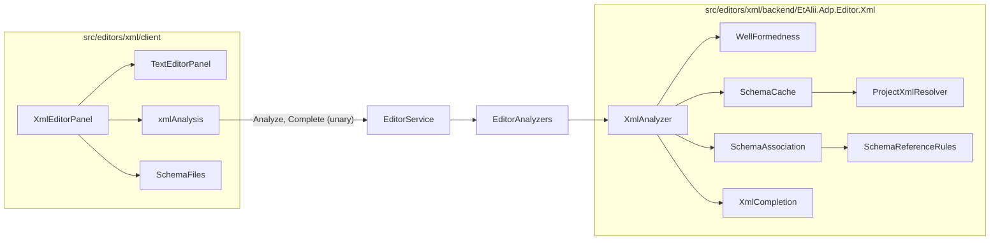

# Design Document

## Overview

The XML editor is a new editor module, `src/editors/xml/`. Its client wraps the shared `TextEditorPanel` with CodeMirror's XML grammar and with an analysis that asks the backend. Its backend holds what the other two editors keep in the client: well-formedness, XSD and DTD validation, and what a schema allows at the caret, all from `System.Xml` and `System.Xml.Schema`. Colour and the presentation of findings and completions are the shared pieces of [`json-editor`](../json-editor/design.md).

The requirements were approved on 2026-10-12 as written, so every open question stands at its default: `.xml`, `.xsd`, `.xsl` and `.xslt` (Q1), schema work in the backend (Q2), findings in the editor only (Q3), internal entities bounded and external ones from the project only (Q4), no `.eds` file (Q5).

**Two sentences of the requirements cannot be met as written.** Both are asked as rulings below, and this design is written for the first option of each.

## What was run before this design

Requirement 1 asks for a spike as the first task. A first run was made on 2026-10-12 as a scratch console program outside the repository, on .NET SDK 10.0.203, Release. **The task still stands**: it repeats this as tests in the module's test project, with a schema of the size the requirement names.

The schema of the run had a sequence, a choice inside it, an all-group, a required enumerated attribute and an optional one, in a target namespace. The validator was fed a document that stops at the caret and then asked.

| Caret | `GetExpectedParticles` answered | Known |
| --- | --- | --- |
| Nothing typed | `cities` (the root) | Run |
| Inside the root, empty | `title` | Run |
| In the sequence, after `title` | `city` | Run |
| Inside `city`, empty | `name` | Run |
| At the choice, after `name` | `mayor`, `council` | Run |
| After the choice | `facts` | Run |
| Inside the all-group, empty | `area`, `founded` | Run |
| Inside the all-group, after `founded` | `area` | Run |
| After a closed `city` | `city` | Run |

| Other question | Answer | Known |
| --- | --- | --- |
| `GetExpectedAttributes` on `city`, none present | `kind` (required), `population` | Run |
| The same, `kind` present | `population` | Run |
| Validating a 5,813-line document | 3.3 ms a run, mean of 20 | Measured. **The schema was 20 lines, not the 2,000 the requirement names.** |
| One completion in the middle of that document | 1.4 ms a run, mean of 20 | Measured, same caveat |
| Compiling the schema | 0.1 ms | Measured, same caveat |
| A document of nested entities with `MaxCharactersFromEntities` set | Refused, with a sentence naming the limit | Run |

So the three unknowns of the requirements are answered for the shapes tried: the validator answers for a document that stops at the caret; a choice offers both branches and an all-group offers what is left; and the cost is milliseconds.

**What the run also showed, by what it could not do.** `XmlSchemaValidator` works on an `XmlSchemaSet`. A DTD is not one. So the platform validates against a DTD and cannot say what a DTD expects next. That is ruling A2.

## Rulings asked

| # | Requirement | What is asked | Options |
| --- | --- | --- | --- |
| A1 | 2.4 and 9.2: the editor's calls "SHALL be the module's own, in `src/editors/xml/api/`, and the shared `EditorService` SHALL NOT learn what XML is"; and "no core file ... SHALL change" | A module cannot bring its own gRPC service today: every service is mapped by name in `Program.cs`, and the client's calls are generated from `src/api/`. Either way one core file changes. | **(recommended) Two calls on the shared `EditorService` that know no format**: `Analyze(text)` and `Complete(text, position)`, answered by whichever module registered an analyser for the tab's editor. The service learns that an editor can be asked about its text, and nothing about XML. The sentences become "the calls are the family's, carry no format, and the module answers them through a seam of the family". The JSON and YAML editors could later answer the same calls if Q3 of `json-editor` is ever revisited. · **A service of the module's own**, as written, with a new discovery step that maps a module's services and generates its client code. Costs a second mechanism in core and in the client's code generation for one module. · Other. |
| A2 | 7, and the introduction's "where the document names an XSD or a DTD" | The platform cannot answer completion for a DTD. | **(recommended) A DTD gives validation and no completion.** A document with a DTD and no XSD gets the findings of Requirement 6 and the end-tag completion of 3.6, and its status line says "DTD: checked, no suggestions". · **Write DTD completion in the module**, from the DTD's content models read by hand. Costs a content-model interpreter this specification would own. · **Drop DTD support**, the second option of Q4. · Other. |

**Ruled by the user in chat on 2026-10-12: the first option of each.** The requirements were amended the same day.

## Steering Document Alignment

### Technical Standards (tech.md)

- **Commands.** A save is the family's `SaveTextFileCommand`. `Analyze` and `Complete` change no state and are not commands.
- **One stream; unary calls.** Both calls are unary. No stream is added.
- **Implementation order.** The seam and its wire shape first (data model and wire), then the backend analyser, then the client. Persistence has nothing in it.
- **Logging.** The analyser holds `private static readonly ILogger _logger = Log.ForContext<XmlAnalyzer>();`. Text is never logged, only the project-relative path.
- **No blocking call in an async method.** The project's files are read with the async overloads; a test passes `TestContext.Current.CancellationToken`.

### Project Structure (structure.md)

`src/editors/xml/` with the family's four folders. The seam lives in `EtAlii.Adp.Editor`, beside `IEditorSessionFactory`; the two calls live in `src/api/editors.proto` and `EditorService.cs`.

## Code Reuse Analysis

### Existing Components to Leverage

- From `json-editor`: `editorHighlight`, `analysisExtensions` with `EditorAnalysis`, `EditorFinding` and `EditorCompletion`, `SchemaFiles`, the shared case file of schema references, and the `editors/*/client` workspace.
- **`ProjectTextFile.TryResolve`** (`src/backend/EtAlii.Adp.Diagram/ProjectTextFile.cs`): resolves a project-relative path inside the project for the calling user. The two new calls use it exactly as `SaveText` does.
- **`TextFileBuffer`**: reads a file of the project with its encoding detected, for schema files and for the declared-encoding check.
- **`EditorSessionFactories`**: the pattern the analyser registry copies, keyed by editor id.
- `PlainEditorSession` and its tests, as the shape of the backend session.

### Integration Points

- `src/api/editors.proto` and `EditorService.cs`: the two calls (A1).
- `toolPanels.ts` and `EditorDefinitionDiscovery`, unchanged.

## Architecture



### Modular Design Principles

- `EditorService` and `EditorAnalyzers` carry text, offsets and sentences. No type in them names XML.
- Each backend file answers one question: is it well-formed, which schema, is it valid, what is expected here.
- Every `XmlReader` and every `XmlSchemaSet` in the module is created by one factory, so that the resolver and the limits cannot be forgotten at one call site.

## Components and Interfaces

### The family's seam (A1)

In `src/api/editors.proto`, beside `SaveText`:

```proto
rpc Analyze(AnalyzeTextRequest) returns (AnalyzeTextResponse);
rpc Complete(CompleteTextRequest) returns (CompleteTextResponse);

message AnalyzeTextRequest  { ShortGuid project_id = 1; Path path = 2; string editor_id = 3; string content = 4; }
message TextFinding         { uint32 from = 1; uint32 to = 2; ProblemSeverity severity = 3; string message = 4; string source = 5; }
message AnalyzeTextResponse { repeated TextFinding findings = 1; string status = 2; repeated Path depends_on = 3; string error = 4; }

message CompleteTextRequest  { ShortGuid project_id = 1; Path path = 2; string editor_id = 3; string content = 4; uint32 offset = 5; bool explicit = 6; }
message TextCompletion       { string label = 1; string detail = 2; string info = 3; uint32 from = 4; uint32 to = 5; string insert = 6; int32 boost = 7; }
message CompleteTextResponse { repeated TextCompletion items = 1; string error = 2; }
```

`from`, `to` and `offset` are offsets into `content` as sent, in UTF-16 units, which is what both CodeMirror and .NET count in. `ProblemSeverity` is the enum the problems vocabulary already has. `depends_on` lists the project files the answer was computed from, so that the client can watch them.

In `EtAlii.Adp.Editor`:

```csharp
public interface IEditorAnalyzer
{
    string EditorId { get; }
    Task<TextAnalysis> AnalyzeAsync(string rootPath, string filePath, string content, CancellationToken cancellationToken);
    Task<IReadOnlyList<TextCompletion>> CompleteAsync(string rootPath, string filePath, string content, int offset, bool isExplicit, CancellationToken cancellationToken);
}
```

`EditorAnalyzers` resolves one by editor id. `EditorService` resolves the path with `ProjectTextFile.TryResolve`, refuses a `content` longer than 1,000,000 characters with a sentence, and answers "This editor has no analysis." for an editor without an analyser. An exception from an analyser is caught, logged once with the path, and returned as `error`.

### `backend/EtAlii.Adp.Editor.Xml`

- **`Editor.cs`**: id `xml`, title "XML editor", icon `mdi-xml`, the four extensions; `Build` registers the session factory and `XmlAnalyzer`.
- **`XmlReaders`**: the one factory. Every reader gets `XmlResolver = ProjectXmlResolver`, `DtdProcessing = Parse`, `MaxCharactersFromEntities = 1_000_000`, `MaxCharactersInDocument` at ten times the request bound, and line information on. Every `XmlSchemaSet` gets the same resolver. The platform's default resolver appears nowhere in the module; an architecture test over the module's source holds that no `new XmlUrlResolver` and no `XmlResolver = null` exists outside this file.
- **`ProjectXmlResolver : XmlResolver`**: resolves a relative URI against the document's or the including schema's folder with `SchemaReferenceRules`, reads the file through `TextFileBuffer`, and records every file it read and every reference it refused with the reason. A URI with a scheme other than the project's is refused: no network, no file outside the root.
- **`SchemaReferenceRules`**: the C# twin of the client's `resolveSchemaReference`, held to the same `src/fixtures/schema-reference-cases.json` by an xUnit test (Requirement 9.6).
- **`WellFormedness`**: reads the text with a non-validating reader to its end or its first `XmlException`, and turns that exception into one finding at its line and column, converted to an offset. .NET's sentences already name both tags of a mismatch, a repeated attribute and an undeclared prefix (4.2 to 4.4). When it stopped, the status says "Not well-formed: the rest was not checked" (4.6). The declared encoding is compared with the one `TextFileBuffer` detected for the file on disk; a difference is one warning on the declaration (4.5).
- **`SchemaAssociation`**: reads the root's start tag and the prolog only, and answers the references: `xsi:noNamespaceSchemaLocation`, the pairs of `xsi:schemaLocation`, the `DOCTYPE`'s system identifier, and an `xml-model` instruction, which is answered as "not supported" with its `schematypens` named (5.1 to 5.3, 5.6). A root that is `xs:schema` marks the document as a schema (5.5).
- **`SchemaCache`**: a compiled `XmlSchemaSet` per set of root schema paths, kept with the last-write time of every file the resolver read for it. Before each use the times are compared; a difference compiles again. The entry is dropped when unused for ten minutes. Compile errors are kept with the entry and reported once per request, naming the schema file and the first error (6.6). An XSD whose root carries `vc:minVersion="1.1"` is answered as not supported (5.6).
- **Validation**: a validating reader over the text with the cached set, or with `ValidationType.DTD` when the document has a `DOCTYPE` and no XSD. Each validation event becomes a finding at its line and column, with the platform's severity (6.1). For an element the range is its name in the start tag; for an attribute or text value, the value (6.2 to 6.4). When `WellFormedness` found an error, validation is not run and the status says "Schema not checked" (6.5).
- **`XmlCompletion`**: first a small scan backwards from the offset decides where the caret is: in text content, in a start tag after the name, inside an attribute value, or somewhere it cannot tell (inside a comment, a CDATA section, or after a syntax error that hides the position), in which case it answers nothing (7.7). Then:
  - **In content**, the text before the caret is fed to an `XmlSchemaValidator` as the scratch run did, and `GetExpectedParticles` gives the elements (7.1). A wildcard particle is not offered. Each element's insert is built from its type: required attributes with empty values and a tab stop in the first, then either `/>` when the type allows no content or a start and end tag with a tab stop between (7.4).
  - **In a start tag**, the element is fed and `GetExpectedAttributes` gives the attributes not yet present, required ones with a boost (7.2).
  - **In a value**, the enumeration facets of the attribute's or element's simple type give the values, and `xs:boolean` gives `true` and `false` (7.3).
  - The prefix for an element's namespace is looked up among the declarations in scope at the caret, which the reader tracks. An element whose namespace has no declaration in scope is offered with the detail "namespace not declared" and inserted without a prefix (7.5).
  - `info` is the text of the particle's `xs:documentation` (7.6). Hover on a name already in the document asks `Complete` at that name and shows the matching item's `info`.
  - With a DTD and no XSD, nothing is offered (A2).

### `client/`

- **`XmlEditorPanel.tsx`**: `TextEditorPanel` with `extensions={[xml()]}` and `analysis={xmlAnalysis}`. `@codemirror/lang-xml` closes a tag as `>` is typed and offers the open element's name after `</` by default, each as one edit, which is Requirement 3.6; a test holds both and that one undo removes each.
- **`xmlAnalysis.ts`**: implements `EditorAnalysis` over the two calls.
  - `findings(text)` sends the text. The shared linter already waits 400 ms and drops an answer for a text that has changed (9.3). A request still in flight when a newer one starts is aborted through the call's abort signal, so at most one is waiting (9.4).
  - Because the answer comes from a call, an edit would otherwise leave the previous answer on screen until the next one arrives. On every edit the panel therefore clears the findings of this source at once (`setDiagnostics` with none) and shows the new ones when they arrive (4.7).
  - `depends_on` is handed to `SchemaFiles`, which opens those files on the connection's stream; a new revision of any of them asks the view to lint again (5.8).
  - A failed call answers no findings and the status "Checking is unavailable", once (9.5).
- **Prefix colour (3.2)**: `@lezer/xml` gives a tag name one tag, prefix included. A small view plugin, in the manner of the YAML editor's scalar colour, marks the part before the colon in the visible range.

### Requirement 10

`src/editors/xml/readme.md` holds the list, with what XML adds, and links the issue the JSON editor opened. Adding to that issue sends content outside this repository, so the task asks the user first.

## Data Models

None persisted. `TextAnalysis(IReadOnlyList<TextFinding> Findings, string Status, IReadOnlyList<string> DependsOn)` and `TextCompletion` mirror the wire shapes above, in `EtAlii.Adp.Editor`.

## Error Handling

| Scenario | Handling | The user sees |
| --- | --- | --- |
| The document is not well-formed | `WellFormedness` stops at the first error | One error where it is; the status says the rest and the schema were not checked. |
| A schema reference names a file that is not there | `ProjectXmlResolver` records the refusal | One information finding on the attribute or `DOCTYPE` that names it. No schema findings. |
| A schema reference is a web address, or leaves the project | Refused by the rules | One information finding saying ADP reads schemas from the project. |
| The XSD does not compile | Kept with the cache entry | One information finding naming the schema file and its first error. |
| An XSD includes a file that is missing | The resolver's refusal surfaces as a compile error | As above, naming the include. |
| RELAX NG, Schematron or XSD 1.1 is named | `SchemaAssociation` or `SchemaCache` | One information finding: named, not supported. |
| Entities expand past the limit | `XmlException` from the reader | One error on the `DOCTYPE` with the platform's sentence. |
| The request is larger than the bound | `EditorService` refuses | The status says "Too large to check". |
| The analyser throws | Caught in `EditorService`, logged once with the path | The status says checking stopped, with the sentence. Colour stays. |
| The backend cannot be reached | The call rejects | The status says "Checking is unavailable". Colour and tag matching stay. |

## Testing Strategy

### Unit Testing

- The spike of Requirement 1, as xUnit tests that stay: the nine caret positions and the two attribute cases of the table above, and the timing with a schema of 2,000 lines, written to the test output and into this document by amendment.
- `WellFormedness.Tests`, `SchemaAssociation.Tests`, `SchemaCache.Tests`, `XmlCompletion.Tests`: one test per criterion of Requirements 4 to 7 that names a behaviour, asserting offsets and severities.
- `SchemaReferenceRules.Tests` over the shared case file.
- **The two security guards**, each seen to fail with its protection removed, as the requirements ask: a document whose `DOCTYPE` names a file outside the project root, with a canary file there whose content must not appear in any answer; and a document of nested entities that must be refused in under a second.
- The source-level test that no reader or schema set is made outside `XmlReaders`.
- Client: `xmlAnalysis.test.ts` with a stubbed transport: a stale answer dropped, an in-flight call aborted, the unavailable status said once.

### Integration Testing

- `EditorService` tests for the two calls: a path outside the project refused, an editor without an analyser answered with the sentence, an oversize text refused, an analyser that throws answered as `error`.
- `XmlEditorPanel.test.tsx`: a file in `depends_on` gets a new revision and the panel asks again.
- `Editor.Tests`, the session tests and `Examples.Tests`, with an example in ISO-8859-1 whose declaration says so, replicas under `src/examples/editors/xml/`.
- The generated client code for `editors.proto` is committed with the change, as the fresh-tree rule requires, and a newly created worktree is built before the gates are trusted.

### End-to-End Testing

Entries in the module's `tests.md`, in a browser against a local build: colour in both themes; a tag closing as it is typed and one undo; a broken XSD constraint's three carriers; completing an element, then an attribute, then an enumerated value from the keyboard alone; editing the XSD in a second tab and seeing the document re-validate; stopping the backend and seeing the status.

### Every guard is seen to fail

Each test written for a behaviour is run once against the behaviour removed and the failure is recorded in the task's log.

## Not in this design

- The Errors and Warnings panel (Q3). With the analyser in the backend it would be a small step: a validator that runs `XmlAnalyzer` on saved files. It is named here because it is cheap, not because it is planned.
- Moving JSON and YAML analysis behind the same two calls. The seam allows it; nothing asks for it.
