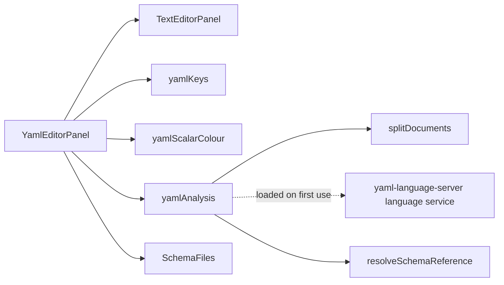

# Design Document

## Overview

The YAML editor is a new editor module, `src/editors/yaml/`. Its client wraps the shared `TextEditorPanel` with CodeMirror's YAML grammar and with an analysis built on the language service of `yaml-language-server`, loaded when the first YAML file is opened. Its backend is the family's session and nothing else. Colour, the presentation of findings and completions, and the rules for where a schema comes from are the shared pieces of [`json-editor`](../json-editor/design.md) and are used here unchanged.

The requirements were approved on 2026-10-12 as written, so every open question stands at its default: `.yaml` and `.yml` (Q1), the `# yaml-language-server: $schema=` line (Q2), no schema by a tool's convention (Q3), YAML 1.2 (Q4), no `.eds` file (Q5).

**One sentence of the requirements cannot be met as written**, because of what the scratch run below found. It is asked as a ruling, and this design is written for its first option.

## What was run before this design

Requirement 1 asks for a spike as the first task. A first run was made on 2026-10-12 in a scratch project outside the repository, with the repository's versions of Vite (8.3.4) and Vitest (4.1.11, jsdom), on `yaml-language-server` 1.25.0. **The task still stands**: it repeats this inside the repository, as tests that stay, and in a browser.

| Question | Answer | Known |
| --- | --- | --- |
| Does the service load and answer under the test runner? | Yes: findings per document of a two-document file, key and value completions, hover text. | Run |
| Does it build for production? | It builds, with six warnings: Node's `path` module is imported by six of its files and Vite leaves it out for a browser. | Run |
| Does the built bundle answer? | **No.** Hover threw `basename is not a function`: the left-out `path`. | Run in Node |
| With `path` replaced? | Yes. With one alias, `path` to `path-browserify`, the build has no warning and the built bundle gives the same answers as the test run. | Run in Node. **Not run in a browser.** |
| What does it add? | 1,438,695 bytes minified, 339,846 gzipped. It carries `ajv` and Prettier's YAML formatter, which the service imports for a formatting feature this editor does not use. | Measured |
| How fast is it? | A 5,000-line document against a 6,276-line schema: validation 78 ms cold and about 58 ms after, asking for completions about 40 ms. | Measured in Node |

What the run showed that the design depends on:

- **Node's `path` is the one Node-only module** (Requirement 1.3). `path-browserify` 1.0.1 is its browser stand-in: MIT, 49.7 million downloads a week on 2026-10-12, the replacement bundlers themselves name. It is a new dependency and gets its row.
- A schema reference with a scheme the service does not know is treated as a file path and mangled. So the module does not let the service find the schema: it reads the comment line itself, resolves it with the shared rules, and hands the service the answer through `registerCustomSchemaProvider`. Run with an `https`-shaped identifier, that worked.
- Schema findings come back as **warnings** and the service has no setting that makes them errors. An unresolved alias comes back as **information**. Requirement 6.1 and 4.4 ask for errors, so the module maps them (below).
- A duplicate key and a broken flow sequence come back as errors, as Requirement 4.1 and 4.3 ask.
- Hover text is markdown and ends with a "Source:" link to the schema. The module shows it as text and drops that line.
- The service's files name validators for draft-04, draft-07, 2019-09 and 2020-12. A reading of file names; the spike task holds one test per dialect.

## Rulings asked

| # | Requirement | What is asked | Options |
| --- | --- | --- | --- |
| A1 | 2.5: "no core file and no shell file SHALL change for it" | The service needs Node's `path` replaced in the browser build. That is one line in `src/client/vite.config.ts`, a file every module shares. | **(recommended) Allow the one alias**, `path` to `path-browserify`, with a comment naming this module, and add `path-browserify` as a dependency. The sentence gains "apart from one alias in the client's build configuration". It affects every import of the bare name `path` in the client; no file under `src/client/src`, `src/diagrams`, `src/designers` or `src/editors` has one today (searched). Three test-support files import `node:path`, a different name the alias is not expected to match; the suite running green with the alias in place is what confirms that. · **Fall back as Requirement 1.4 names**: read with `yaml` and validate the data with the JSON editor's service, completion written in this module. No shared file changes and about 1.2 MB less to download; costs writing and maintaining YAML completion, and positions for findings mapped by hand. · Other. |

**Ruled by the user in chat on 2026-10-12: the first option.** The requirements were amended the same day.

## Steering Document Alignment

### Technical Standards (tech.md)

- **Commands.** A save is the family's `SaveTextFileCommand`; the editor adds no state change.
- **One stream.** Nothing is added to the wire.
- **Implementation order.** Data model, persistence and wire have nothing in them for this module, stated so that the tasks carry no empty steps.

### Project Structure (structure.md)

`src/editors/yaml/` with the family's four folders. With A1, one line outside it.

## Code Reuse Analysis

### Existing Components to Leverage

- From `json-editor`: `editorHighlight`, `analysisExtensions` with `EditorAnalysis`, `EditorFinding` and `EditorCompletion`, `resolveSchemaReference`, `SchemaFiles`, and the `editors/*/client` workspace.
- `TextEditorPanel`, `BaseTextEditor`, `useEditorText`.
- `PlainEditorSession` and its tests, as the shape of the backend session.
- `@codemirror/language`: `indentUnit`, `indentService`.

### Integration Points

- `toolPanels.ts` and `EditorDefinitionDiscovery`, unchanged.
- `src/client/vite.config.ts`: the alias of A1.

## Architecture

### Modular Design Principles

- The service is behind one file, `yamlAnalysis.ts`, and is imported with `import()`. Its 340 KB (gzipped) are fetched when a YAML file is first opened, never with the shell, and never for a user who opens none.
- Everything the module adds to the shared pieces goes through their interfaces. Two things YAML needs are already there by design: a finding carries offsets into the whole text, so a finding of the third document of a file needs no new field; a completion carries its own insert text, so indentation is the module's to compute.

## Components and Interfaces

### `backend/EtAlii.Adp.Editor.Yaml`

`Editor.cs`: id `yaml`, title "YAML editor", icon `mdi-code-braces-box`, extensions `.yaml` and `.yml`. `YamlEditorSession` and its factory hold the family's contract. `YamlDotNet` is not referenced.

A `.yml` file that is a diagram's body keeps opening its diagram: the resolver asks editors only when no diagram claims the file, and "Open as text" asks for the editor by extension (Requirement 2.3). That is existing behaviour and is held by one test with the Azure DevOps pipeline example.

### `client/YamlEditorPanel.tsx`

`TextEditorPanel` with `extensions={[yaml(), yamlKeys, yamlScalarColour]}` and `analysis={yamlAnalysis}`; mounts `SchemaFiles` for the schemas the analysis needs.

### `client/yamlKeys.ts` (Requirement 3.5, 3.6)

- The indentation width is read from the document: the smallest indentation of any line that is indented, and two when none is. It is set as `indentUnit`.
- **Tab** inserts spaces to the next multiple of that width at the caret, and indents the selected lines when there is a selection. Shift+Tab removes one level. A tab character is never inserted.
- **Enter** uses the YAML grammar's own indentation: the indentation of the line left, one level more after a key with nothing after its colon and after a `-` that opens a mapping.
- Folding is the grammar's, through the shared `foldGutter`.

### `client/yamlScalarColour.ts` (Requirement 3.2)

The grammar gives every unquoted scalar one tag, so it cannot tell `1.10` from `ten`. A view plugin decorates each plain scalar in the visible range with the class of the type YAML 1.2's core rules read it as (number, boolean, null, or none for a string), using the same patterns the `yaml` parser uses, and the class takes the shared token's colour. It reads only the visible lines.

### `client/splitDocuments.ts` (Requirement 4.5, 5.2)

The service takes one schema for one file. A file of several documents, each with its own schema line, is therefore split: `splitDocuments(text)` gives each document's start and end offset, by the `---` and `...` markers the `yaml` parser reports, and the schema line found in the comments before its first content. Each document is analysed on its own under its own URI, and every range that comes back is shifted by the document's start. A file of one document is the common case and takes the same path with one part.

### `client/yamlAnalysis.ts`

The only file that knows the service.

- **Schema.** For each part, the reference from `splitDocuments` goes through `resolveSchemaReference`; a `project` or `bundled` answer is registered under an identifier of the form `https://adp.invalid/` plus the path, which the service's `schemaRequestService` callback is asked for and answers from `SchemaFiles`. A schema written in YAML is parsed with `yaml` and handed over as JSON text (5.5). A `none` answer becomes one information finding on the comment line (5.3).
- **Findings.** The service's diagnostics are mapped to `EditorFinding`, with three adjustments:

  | From the service | Becomes | Why |
  | --- | --- | --- |
  | A schema violation (warning) | error | Requirement 6.1 |
  | A deprecated key (warning) | warning | Requirement 6.4 |
  | An unresolved alias (information) | error | Requirement 4.4 |

  Which diagnostic is which is decided by the service's own `source` and `code` fields where it sets them. The scratch run printed sentences and severities only, so **which field tells them apart is not yet known**; the first implementation task reads it from a run and records it. If no field does, the alias check is done by this module from the `yaml` parser's own document, which knows its anchors, and the schema violations are told apart by being every warning that is not about deprecation.
- **Tabs.** A tab used for indentation is reported by the parser as an error; a test holds that the finding sits on the tab (4.2).
- **Aliases and merge keys (6.3).** The service validates the data an alias stands for. Where its finding sits (at the alias or at the anchor) was not looked at in the scratch run. A test fixes what Requirement 6.3 asks; if the service places it at the anchor only, the module adds the same finding at each alias that reaches the value, found through the parser's document.
- **Completions.** Mapped to `EditorCompletion`. The service computes the mapping from the caret's indentation (7.1) and inserts at that depth (7.4). Two items that would insert the same text are shown once. On an empty line Ctrl+Space asks explicitly (7.5).
- **Hover.** The service's markdown is reduced to text: headings and emphasis marks are stripped, the "Source:" line is dropped.
- **Limits.** Above the JSON editor's 1,000,000 characters: no findings, status "Too large to check". `yaml`'s own bound on alias expansion (`maxAliasCount`, 100 by default) is left at its default and a document that passes it gets the parser's error as a finding (Security).
- **Tags.** The service reads to a data structure and constructs nothing; unknown tags are kept as strings. No custom tag is registered.
- **Failure.** A throw is caught once per document: findings fall back to the `yaml` parser's own errors, and the status says "Schema support stopped:" and the message.

### What the module never does (Requirement 8.2)

`yamlAnalysis` receives text and returns ranges and strings. Nothing it parses is serialised, and no function of the module returns a text for the editor other than a completion's insert. The service's formatter is not registered and no key reaches it. One test saves every example after a full analysis pass and compares bytes.

### Requirement 10

`src/editors/yaml/readme.md` holds the list, with what YAML adds, and links the issue the JSON editor opened. Adding to that issue sends content outside this repository, so the task asks the user first.

## Data Models

None persisted. `YamlPart { from: number; to: number; schemaReference?: string; schemaLine?: number }` is the one in-memory shape the module adds.

## Error Handling

| Scenario | Handling | The user sees |
| --- | --- | --- |
| The schema line names a file that is not there | `SchemaFiles` reports the failed open | One information finding on the comment line naming the reference. |
| The schema line names a web address | `resolveSchemaReference` answers `none` | One information finding saying ADP reads schemas from the project. |
| The schema is neither valid JSON nor valid YAML | Caught when it is parsed | One information finding saying the schema could not be read. |
| One document of several is not well-formed | Each part is analysed alone | That part's syntax findings; the other parts' findings stay. |
| A file with Helm or Jinja braces | It is not YAML | The parser's findings, where they fall. Out of scope says so. |
| The service throws | Caught in `yamlAnalysis` | Colour and the parser's findings stay; the status line says why schema support stopped. |
| The chunk does not arrive | The `import()` rejects | Colour stays; the status line says checking is unavailable. |

## Testing Strategy

### Unit Testing

- `splitDocuments.test.ts`: one, two and three documents; markers inside block scalars and quoted strings, which are not markers; a schema line before each; CRLF text after the panel's normalisation.
- `yamlAnalysis.test.ts`: one test per criterion of Requirements 4, 5, 6 and 7 that names a behaviour, asserting ranges and severities.
- `yamlKeys.test.ts`: Tab, Shift+Tab and Enter on documents indented by two and by four.
- `yamlScalarColour.test.ts`: `yes`, `1.10`, `0x1f`, `~`, `null`, `true`, a date, each against the type YAML 1.2 gives.
- The spike tests of Requirement 1, kept: one per dialect, one for completion, one for hover.

### Integration Testing

- `YamlEditorPanel.test.tsx`: a schema arriving after the document; a second document with a different schema.
- A build test: the client's production build is searched for the externalised-module placeholder Vite leaves behind, and must not contain it. It is the guard for A1's alias and is seen to fail with the alias removed.
- Backend: `Editor.Tests`, the session tests and `Examples.Tests`, with a CRLF example and a multi-document example, replicas under `src/examples/editors/yaml/`.
- The JSON editor's tests stay green over any widening of a shared piece (Requirement 9.2). None is planned.

### End-to-End Testing

Entries in the module's `tests.md`, in a browser against a local build: colour in both themes; Tab and Enter; a broken schema's three carriers; completion from the keyboard at two depths; "Open as text" on a pipeline's `.yml` while its diagram is open, a save, and the diagram following. The first entry is the production-build half of Requirement 1.2 and includes a hover, the call that failed without the alias.

### Every guard is seen to fail

Each test written for a behaviour is run once against the behaviour removed and the failure is recorded in the task's log.

## Not in this design

- Removing Prettier from the bundle. The service imports it statically for its formatter; leaving it out would mean a second alias to an empty module, which is a larger intervention in a shared file than A1 asks for. It is noted with its measured cost so that it can be asked separately.
- A worker thread. At about 60 ms a validation after a 400 ms pause it is not needed; the analysis interface is asynchronous so that moving it later changes one file.
