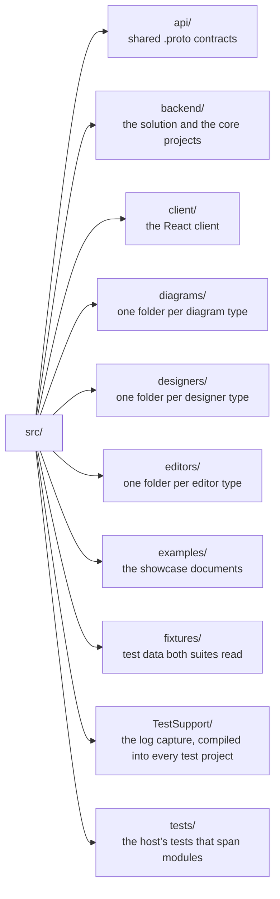

# The solution structure

**Where the code is, how much of it there is, and which project owns what.** Its companion is [architecture.md](architecture.md), which answers *what the system is* rather than *where it lives*.

## The shape of `src/`

`src/TestSupport` is **not** a project. It holds two source files, the log capture, that `src/Directory.Build.targets` compiles *into* each `*.Tests` project, deliberately rather than as a referenced assembly — the reasoning is in that file and is load-bearing. Do not confuse it with `EtAlii.Adp.TestSupport`, which **is** a project, under `src/backend`, and which the same file attaches to every `*.Tests` project as a project reference: helpers that do not install themselves per assembly (`TestFolder` among them) live there, where every core and module test project reaches them, its namespace a global using of each.

## The solution, with its counts

`src/backend/EtAlii.Adp.slnx` holds **146** projects: the core projects at its root, the modules in one solution folder per kind (`/Diagrams/`, `/editors/`, `/designers/`) and the test project that spans modules in `/tests/`, so the whole thing opens and builds as one solution in Rider:

| Split | Count |
| --- | --- |
| core | **45** |
| diagram | **86** |
| editor | **10** |
| designer | **4** |
| spanning modules | **1** |
| production | **97** |
| test | **49** |

Those are **two different splits of the same 146**, and a figure appearing in both tables is a coincidence rather than a correspondence, which is exactly what makes a wrong classification look right.

There are **169** tracked `.csproj` files under `src/`, which is **23** more than the solution holds. Every one of the 23 is fixture or example data of the dotnet-dependency-graph module — a module whose subject matter *is* reading `.csproj` files, so its test fixtures and its showcase project are themselves `.csproj`, in `src/diagrams/dotnet-dependency-graph` and in the showcase copy under `src/examples/`. **A page giving the tracked count as the number of projects would be wrong in the confident direction.**

## The relative-path trap

**The solution's project paths are relative to `src/backend/`.** A core project therefore appears as `EtAlii.Adp.Context/EtAlii.Adp.Context.csproj` with no `backend` segment, while a diagram project appears as `../diagrams/<type>/backend/...`.

Classifying by path segment — "count the ones containing `backend`" as the core — yields a plausible split that is the core/module split with its labels swapped: every module path contains `backend` and no core path does. When this page was first written that split was 78 / 27 and matched the production/test sizes exactly, which is how it survived a sanity check; the coincidence has since ended, and the trap has not. **Classify core projects by the absence of a leading `../`.**

## The core projects

**23** production:

| Concern | Project |
| --- | --- |
| Shared primitives | `EtAlii.Adp` |
| Host and composition, including serving the built client and proxying to the Vite dev server | `EtAlii.Adp.Backend.Service` |
| Sign-in: the authenticator, the login and which calls need no session | `EtAlii.Adp.Authentication` |
| Open documents and the shared wire vocabulary | `EtAlii.Adp.Documents` |
| Writing a file whole, what holds a file open, whether two paths are one file, and watching a file, a folder and a project's files | `EtAlii.Adp.Files` |
| Selection, actions, properties, prompts | `EtAlii.Adp.Context` |
| Commands and undo/redo | `EtAlii.Adp.History` |
| Errors and warnings | `EtAlii.Adp.Problems` |
| Known projects and workspace roots | `EtAlii.Adp.Projects` |
| Every kind of session: sign-in sessions (the session store, the session context and the interceptor that checks every call), the tool-session contracts of the three kinds with their factory contracts and registries, the document session and the text editor session a module builds on, the viewport registry, and the connection and project sessions that acquire and release what a connection holds; it references the diagram, designer, editor and history projects, never the reverse | `EtAlii.Adp.Sessions` |
| Workspace tree, kept current from the project's file events | `EtAlii.Adp.Hierarchy` |
| Geometry with no dependency: the rectangle, the viewport test's operand, row packing, the row a drag snaps to, text width and graph layering | `EtAlii.Adp.Layout` |
| Diagram-type abstractions, including the diagram definition and validation contracts; it references the documents project and the shared primitives only | `EtAlii.Adp.Diagram` |
| The bases a module builds on: the provider frame, the element source resolvers, a bundled DISL definition as a module's palette, menus and rows, and the viewport test | `EtAlii.Adp.Diagram.Modules` |
| The services a connection calls, its connections and their streams, the table wire, the editor plumbing and the reload bridge | `EtAlii.Adp.Workspace` |
| Editor-family abstractions | `EtAlii.Adp.Editor` |
| Designer-family abstractions: the definition, its discovery and its catalog, and the models the table and hierarchy surface sessions speak | `EtAlii.Adp.Designer` |
| Test helpers shipped as a project, referenced by every test project | `EtAlii.Adp.TestSupport` |
| The in-process host the flow tests drive: one host per test class, a signed-in session, stream probes and the steps the flows share | `EtAlii.Adp.TestSupport.Host` |
| Reading and writing bodies through FBL bindings (Format Binding Language) | `EtAlii.Adp.Specification.Fbl` |
| Evaluating CEL expressions (Common Expression Language), for FBL and DISL alike | `EtAlii.Adp.Specification.Cel` |
| What the DISL and FBL loaders share: the diagnostic a loader reports and its severity | `EtAlii.Adp.Specification.Json` |
| Loading DISL specifications (Diagram Specification Language) and the bundled definitions, building a diagram's model from a reading, and deriving its toolbox, context menus, property rows, findings and gesture refusals, and running its operations, hooks and deletion policy, and giving the FBL library the attribute types of a binding | `EtAlii.Adp.Specification.Disl` |

**22** test: `EtAlii.Adp.Tests`, `EtAlii.Adp.Authentication.Tests`, `EtAlii.Adp.Backend.Tests`, `EtAlii.Adp.Client.Tests`, `EtAlii.Adp.Context.Tests`, `EtAlii.Adp.Designer.Tests`, `EtAlii.Adp.Diagram.Tests`, `EtAlii.Adp.Diagram.Modules.Tests`, `EtAlii.Adp.Documents.Tests`, `EtAlii.Adp.Editor.Tests`, `EtAlii.Adp.Hierarchy.Tests`, `EtAlii.Adp.History.Tests`, `EtAlii.Adp.HostLogging.Tests`, `EtAlii.Adp.Layout.Tests`, `EtAlii.Adp.Problems.Tests`, `EtAlii.Adp.Projects.Tests`, `EtAlii.Adp.Repository.Tests`, `EtAlii.Adp.Sessions.Tests`, `EtAlii.Adp.Specification.Cel.Tests`, `EtAlii.Adp.Specification.Disl.Tests`, `EtAlii.Adp.Specification.Fbl.Tests`, `EtAlii.Adp.Workspace.Tests`.

Not every production project has a matching test project, and that is not a gap to close by reflex — some are covered from `EtAlii.Adp.Backend.Tests`, and `EtAlii.Adp.Files` from `EtAlii.Adp.Documents.Tests`.

**No project a tool module reaches carries a hosting package.** ASP.NET Core and the gRPC server are in the host project and in the projects only the host reaches: authentication, problems and workspace. The context, hierarchy, projects and sessions projects take the gRPC API alone (`Grpc.Core.Api`), and the shared primitives, editor and designer projects take the generic host's abstractions (`Microsoft.Extensions.Hosting.Abstractions`) for `IHostApplicationBuilder`. `ModuleHostingPackages.Tests` holds this.

**This list was measured from the solution, not written from memory**, and `ArchitecturePages.Tests` holds it there: every name above must be a project in `EtAlii.Adp.slnx`. That guard is the whole reason to trust it. The list this replaced was written from memory, named two projects that have never existed, and omitted fifteen that do — and it read as authoritative for as long as nothing checked it.

## A module's folder shape

A diagram type is `src/diagrams/<type>/` with up to five parts:

- `backend/` — its project, `EtAlii.Adp.Diagram.<Type>`, and `.Tests` where it has tests of its own
- `api/` — its own `.proto`, when it has wire messages of its own
- `client/` — its canvas and registration
- `definition/` — its DISL definition (`<type>.dis`, its prose and `provenance.json`; one `<type>.dis` with its own `<type>.provenance.json` per type where several types read one body, as C4's six do), bundled from etalii-adp/etalii.adp by `src/diagrams/tools/bundle-disl.sh`, when the type is specified in DISL; the backend embeds it and the client compiles its notation
- `examples/` — documents a reader can open

Editors are the same shape under `src/editors/<type>/`, with `EtAlii.Adp.Editor.<Type>`. Designers are too, under `src/designers/<type>/`, with `EtAlii.Adp.Designer.<Type>`: `src/designers/knowledge` and `src/designers/hierarchical-requirement`. [creating-a-diagram-module.md](creating-a-diagram-module.md) walks one module end to end.

## Namespaces, and the folders that do not contribute

Namespaces are `EtAlii.Adp.<Area>`, following the project rather than the folder tree — `EtAlii.Adp.Backend.Service`, `EtAlii.Adp.Context`, `EtAlii.Adp.Diagram`. A test project appends `.Tests`. Outside .NET the same intent is spelled the language's own way, as `com.etalii.adp.<area>`. .NET types and their files are `PascalCase`; the client follows its own tooling's convention, kept consistent within the client.

**`EtAlii.Adp.Diagram` is singular, and carries no `Backend` segment.** A plural form and a `Backend`-prefixed form have both been written down as though they existed — three times between them, one of which was the naming rule's own worked example, so the rule told a reader checking against it the wrong answer. **This page cannot spell either form**, even to deny it: the guard rejects any `EtAlii.Adp.*` name on it that is not a project in the solution, which is what found the third instance and then immediately caught this sentence's first draft.

Folders that hold a kind of type rather than an area are deliberately **skipped** when a namespace is derived, chiefly `_Model` and `Commands`, and `Support` in test projects, so a type in `Hierarchy/Commands/` stays in `EtAlii.Adp.Hierarchy`. Several projects skip further folders of their own.

The skips are declared per project in a `.csproj.DotSettings` file, and `NamespaceProviders.Tests` asserts, for every non-test project under `src/backend`, that every declared namespace matches project-plus-unskipped-folders. **A namespace that looks wrong for its folder is usually right**; check the `.DotSettings` before "correcting" it.

**Identities are `ShortGuid`** (`src/backend/EtAlii.Adp/ShortGuid.cs`): a `Guid` in a fixed-length 25-character base36 form, used wherever an id is needed. The base36 spelling is a display and URL concern — on the wire it travels as a `Guid`. The steering documents called this type `ShortId` until this page replaced them, and no such type has ever existed.

## Where tests and fixtures live

A test project sits beside its subject as `<Project>.Tests`, or is named for its purpose as `EtAlii.Adp.<Purpose>.Tests` where it has no single subject project: `EtAlii.Adp.Client.Tests` runs the client suite, `EtAlii.Adp.Repository.Tests` holds the guards whose subject is the repository itself - its documents, scripts and conventions - and `EtAlii.Adp.HostLogging.Tests` exists to hold **one class on purpose**. That class asserts which host's pipeline the process-wide `Log.Logger` points at, and a test assembly is its own process, so no other class's host can move it; a second host-booting class there ends that. Inside one, `Fixtures/**` is **test input, not product** — and for the modules whose round-trip requirement compares bytes, those fixtures are marked `-text` in `.gitattributes` so git does not rewrite their line endings and turn the test into a test of git.

**A flow that tests one module lives in that module's own test project**, whether or not it names the module's types, and that project references `EtAlii.Adp.TestSupport.Host` for the host and the steps the flows share; `src/diagrams/timeline/backend/EtAlii.Adp.Diagram.Timeline.Tests/TimelineFlow.Tests.cs` is one. **A test of the host that spans modules lives in `EtAlii.Adp.Modules.Tests`**, in `src/tests/EtAlii.Adp.Modules.Tests/`: what every module draws and declares, every shipped example as its canvas receives it and every example registration opened against the catalog, the restore and the claims several modules share, and the checks that core names no module. It sits outside `src/backend` so that it is no core project, and it reaches the modules through the host project, which deploys them all. `EtAlii.Adp.Backend.Tests` names no module in code and **holds no flow that tests one module**: its flows test the host itself, some of them through one module's documents as the vehicle - a mind map for selection, problems and the toolbox, a knowledge table for the workspace stream.

`src/fixtures/cross-tier/` is a different thing with a similar name: **one JSON file per rule the backend and the client must agree on**, each carrying its cases and the rule's own statement in a `reason` field, and read by both suites. Two parts of it are generated rather than written: its `example-models/` folder, where `ShippedExampleModelsTests` writes every shipped example as the stream a canvas receives and the client's emitter guard mounts every canvas on it, and `element-types.json`, which `ElementTypesTests` writes from each module's own type constants; both tests are in `EtAlii.Adp.Modules.Tests`. Each test rewrites its file and fails when the checked-in copy is stale. It sits outside both because a client test reaching into the backend's folders would invert the dependency the whole tree is arranged to avoid. Beside that folder, `src/fixtures/schema-reference-cases.json` is the same kind of file for the editor family: where a schema reference points, read by the client's `resolveSchemaReference` and by the XML editor's C# twin of it, `SchemaReferenceRules`.

Showcase documents live in `src/examples/`, not in a module's `Fixtures/`. The two look alike and are not: one is read by tests, the other is opened by a person.

`src/examples/` is itself one ADP project — the folder a reader opens to meet every type in a single explorer tree — and a module joins it by having its examples copied in, under `src/examples/diagrams/<type>/<set>/`, `src/examples/designers/<type>/<set>/` or `src/examples/editors/<type>/<set>/`. **The showcase nests by how a diagram reads rather than by module, and it does so inconsistently**, so a path built by rule from a module's name will miss; list the folder instead. A tree comparison that maps one side onto the other by path will report files as missing that are simply somewhere else.

**The two copies are deliberately no longer identical**, since 2026-09-04. They were, byte-for-byte, with a test enforcing it — but the showcase is a working surface, and arranging a diagram in the running app writes a `layout:` block into the showcase copy while the module copy stays put. The guard read five instances of ordinary use as drift and was removed. What still holds of both trees is that every example registration opens against the deployed catalog, which `ExampleRegistration.Tests` walks in both places. **A module may still hold its own copies identical**, and six do: dependency-graph and all five editors each require a byte-identical replica from their own `Examples.Tests`, so "the trees are unsynced" is true tree-wide and false for those six.

## What this page is not

**Descriptive, not normative.** It says where things are; the rules live in [`CLAUDE.md`](../CLAUDE.md) and the steering documents, and when this page disagrees with a rule, the rule wins and this page is stale.

**Refresh rule:** [`CLAUDE.md`, *The architecture pages*](../CLAUDE.md#the-architecture-pages) - update the page in the same change that makes one of its sentences false, as [*Documentation refresh*](../CLAUDE.md#documentation-refresh) asks of every delivered document.

**Not covered here, deliberately** (a later pass, each its own specification): what is inside a module, the wire contracts and generated code, the client component tree, deployment and hosting, and the editor family's internals.

**Its guard is `ArchitecturePages.Tests`** (`src/backend/EtAlii.Adp.Repository.Tests/ArchitecturePages.Tests.cs`), listed in [guards.md](guards.md). It checks that every path and project name here exists, that every figure written in bold is a value the tree recomputes (without binding it to its label), and that the page stays within its size limit. It does not check that a list is complete.

**It cannot check whether a description is still accurate.** Every bold count on this page is guarded; every *sentence* around them is not. A concern column that names the wrong project would pass silently, because the project exists.
